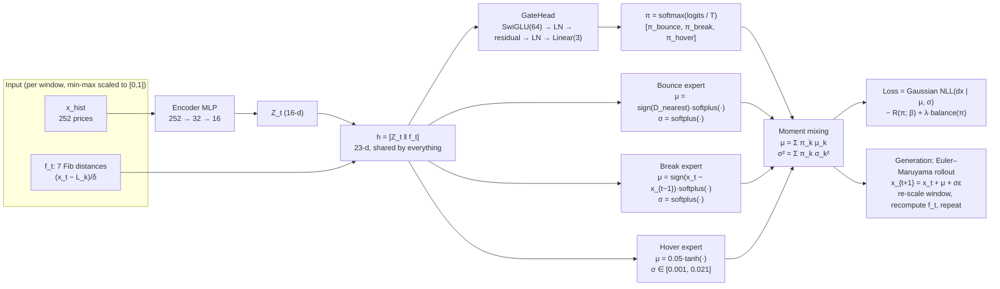
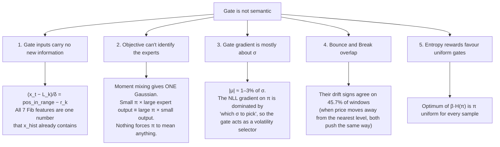
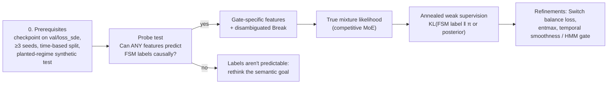

# Fibonacci Neural SDE: paper, gating problem, and experiments

Study notes, 2026-11-08. Sources: the paper `fibonacci_neural_sde/Fibonacci_Neural_SDE.pdf`, the code on `main` (commit a2d27cf), and the benchmark outputs in `workspace/neural_SDE/gating_diagnostics_benchmark/20261004_185041`. All repo paths below are relative to `fibonacci_neural_sde/`.

## 1. What the paper proposes

*Synthetic Stock Data via a Mixture of Experts Neural SDE: Modeling Fibonacci Levels* (Javid & Molavipour) builds a generator of synthetic stock prices. The setup:

- It looks at the last 252 days of prices. It computes the 7 Fibonacci retracement levels between that window's low and high (0, 23.6%, 38.2%, 50%, 61.8%, 78.6%, 100%). It also computes how far today's price is from each level, as a fraction of the range: `D_t = (X_t − F_t)/δ_t`.
- It predicts tomorrow's price with an SDE, `dX = μ dt + σ dW`. The drift μ and the volatility σ come from a mixture of 3 experts (MoE). Each expert stands for one kind of price behaviour:
  - **Bounce:** the drift is forced to push away from the nearest level (support/resistance holds).
  - **Break:** the drift is forced to follow the latest move (momentum carries through the level).
  - **Hover:** the drift is close to zero and σ is small (the price consolidates at the level).
- A **gate** (a softmax over the 3 experts) decides how much each expert counts. Its weights mix the outputs as `μ = Σπμ_k` and `σ = √(Σπσ_k²)`.
- Training uses a one-step Gaussian negative log-likelihood (NLL), minus `β·entropy(π)`. The entropy term is there to stop the gate "collapsing" onto one expert early in training.
- The paper evaluates with:
  - return, volatility and max-drawdown histograms against real data and a Vasicek/OU baseline;
  - Jensen–Shannon distances between how often Fibonacci "events" occur in real and synthetic paths (MoE 0.04–0.13, MLP 0.11–0.19, Vasicek 0.30–0.42);
  - TSTR (train on synthetic, test on real) with a trend classifier: 100% synthetic data gives 61.83% vs 61.88% for real data.

The paper's story is that the gate is **interpretable**: it should say "this is a Bounce/Break/Hover situation". That claim is what the gating problem is about.

## 2. Architecture

Key files:

- `amgm/models/mlp.py`: `NeuralSDEMoE`, `GateHead`, `ExpertHead`.
- `amgm/models/neural_SDE/runner.py`: NLL and loss assembly, β and temperature schedulers.
- `amgm/models/neural_SDE/gate_regularizers.py`: the regulariser modes.
- `experiments/neural_SDE/trainer_cfg/neural_SDE/US_Stocks.py`: all hyperparameters.

Two differences between the paper and the code:

- **Data:** the paper says 50 stocks from 2014–2017. The config uses 100 stocks from 2014–2020.
- **Encoder:** the paper says 64/32 hidden units. The code uses 252→32→16.

## 3. The gating problem

**The goal:** the gate should put high weight on Bounce when the price is actually bouncing off a level, on Break when it breaks through, and on Hover when it consolidates. That is "semantic" gating.

**What happens instead:** the gate either:

- **collapses or starves:** one expert takes everything, or one expert is never used (Bounce wins 0% in the baseline); or
- **stays near-uniform:** π ≈ (⅓, ⅓, ⅓) everywhere, so it barely depends on the input; or
- **turns sharp but arbitrary:** confident routing that has nothing to do with Fibonacci events.

In every variant tried, the mutual information between the event label and the winning expert is **≤ 0.01** of the label's entropy. In practice the gate tells you nothing about Bounce/Break/Hover.

### Why this happens (root causes)

Some detail on the main ones:

1. **Empty Fibonacci features.** `L_k = min + r_k·δ`, so `(x_t − L_k)/δ = (x_t − min)/δ − r_k`. The 7 "distances" are the current position in the range shifted by constants, and the encoder already sees that position. The gate learns nothing about levels that it didn't already have.
2. **Moment mixing instead of a real mixture.** The likelihood only sees the blended μ and σ, so the gate weights aren't identifiable. A real mixture-of-experts likelihood makes experts compete for data points. Moment mixing doesn't.
3. **Weak drift signal.** On daily data, the per-step drift is tiny compared with the noise. Bounce versus Break is a statement about drift *direction*, and that is almost invisible to a one-step NLL. Hover is the only expert with a clearly different σ (it is capped low), so the gate learns "low-vol vs high-vol", not "bounce vs break".

   Formally, with `L = ½log σ² + ½r²/σ²`, `r = dx − μ`:

   `∂L/∂π_k = ½(σ_k²/σ²)(1 − r²/σ²) − r·μ_k/σ²`

   Because `|μ_k| ≪ σ`, the variance term dominates.

## 4. Experiments done so far

There are two rounds. Commit 3589340 and the branches `daniel/resolve-moe-collapse` and `feat/multiple-regularization-technique` added the regularisers. `elias/gating-statistical-analysis` added the diagnostics.

### Diagnostics tooling (how the gate is measured)

| Experiment | What it does |
|---|---|
| **Exp 1:** training history (`--gating-diagnostics`) | Logs per-epoch gate entropy, confidence, mean π per expert, winner share, and how often windows switch winner between epochs |
| **Exp 2:** real trajectories (`analyze_gating`) | Runs the trained gate on real 2018–2020 paths. Runs the Fibonacci state machine (FSM) to label real Bounce/Break/Hover events. Checks whether π matches the labels at event time |
| **Exp 4:** temporal consistency (`analyze_temporal_gating`) | Switches per 100 steps, how long the gate stays on one expert, transition matrices, real vs synthetic rollouts |

The first baseline runs (`workspace/neural_SDE/gating_diagnostics/baseline_20260930*`) showed **hard collapse**: Hover had π ≈ 0.96.

### Regulariser benchmark (`gating_diagnostics_benchmark/20261004_185041`, seed 1, 20 epochs)

The loss is `NLL − R(π; β) + λ·balance`. Each variant changes R or the softmax temperature:

| Variant | What the method does | Val entropy | Val winners B/Br/H | val loss_sde | Real winners B/Br/H | MI(event; winner) | Verdict |
|---|---|---|---|---|---|---|---|
| **baseline (entropy)** | Rewards high per-sample entropy, β·H(π), so each sample's gate is pushed toward uniform | 0.925 | .00/.46/.54 | −2.399 | .00/.65/.35 | 0.001 | starved Bounce, uniform-soft, non-semantic |
| **adaptive_entropy** | Same, but β_k is scaled up for under-used experts: β/(p̄_k·K) | 0.928 | .37/.11/.53 | −2.387 | .61/.09/.30 | 0.002 | uniform-soft, non-semantic |
| **temperature 5→0.5** | softmax(logits/T): starts very soft (T=5) to explore, then anneals to sharp (T=0.5) | 0.938 | .01/.86/.13 | −2.406 | .76/.12/.12 | 0.009 | starved, uniform-soft, non-semantic |
| **adaptive_entropy + temperature** | Both of the above | 0.954 | .67/.25/.08 | −2.406 | .80/.15/.06 | 0.009 | uniform-soft, non-semantic |
| **regional_variance** (β 7→1.5, λ=2, T anneal) | Rewards variance of π_k *across the batch*, so each sample should pick one expert and different samples different ones. The balance loss keeps the averages at ⅓ | **0.009** | **.32/.33/.35** | −2.370 | .22/.41/.37 | 0.006 | non-semantic |

Input dependence, I(X;E)/log 3: baseline 0.035, adaptive_entropy 0.068, temperature 0.053, AE+temperature 0.044, regional_variance 0.991.

**What these results show:**

- **The entropy family** (the first four rows) changes *which* expert wins, but the gates stay near-uniform: entropy ≈ 0.93, confidence ≈ 0.45. The "winner" is decided by tiny margins, so it flips between validation and real data. For example, temperature gives Break 86% on validation but Bounce 76% on real data.
- **`regional_variance` fixed the collapse.** It gives sharp (entropy 0.009), balanced (⅓ each) routing that strongly depends on the input (I(X;E)/log 3 = 0.99). It costs about 0.03 nats of NLL. But the routing **does not line up with Fibonacci events**: event contrast is 0.002.
- **No variant is semantic.** The bottleneck is the inputs and the objective, not how strongly the regulariser is set.
- **Caveats:**
  - Everything is a single seed, so treat ~0.01 differences in `loss_sde` as noise.
  - Validation is a random split of overlapping windows, which is effectively in-sample.
  - The Exp 2 period (2018–2020) overlaps the training data.
  - The FSM labels use 9 days of hindsight and cover only about 3% of windows.
- **`mutual_info`** (rewards confident per-sample gates that are still balanced on average) is implemented but has never been benchmarked.

## 5. Other approaches

Ordered roughly by expected impact. The ones that matter most change the **inputs** and the **objective**, not the regulariser.

1. **Run a probe test first.** Using the existing checkpoint, fit logistic regression or a small MLP to predict the FSM event label from different feature sets: `f_t`, `Z_t`, `h`, and new hand-built features. This costs no SDE training. It tells you whether the event information exists but the objective ignores it, or whether the labels can't be predicted causally at all.

2. **Give the gate its own informative inputs.** The current Fibonacci features are redundant. Compute about 10–14 features from raw prices:
   - level distances measured in volatility units, `(P − L_k)/(σ20·P)`;
   - an approach indicator: is the price moving *toward* the nearest level?
   - velocity over 1, 5 and 10 days;
   - `log(σ20/σ60)`;
   - range divided by volatility;
   - days spent in the ±2% zone.

   Feed these to the gate only; the experts keep `h`. Mirror any feature change in `generate_samples._compute_features` and `gating_diagnostics/statistics.window_features`.

3. **Make Bounce and Break true opposites.** Define Break as continuation *through* the nearest level, `μ_break = −sign(x_t − L*)·softplus(·)`. Right now Break follows the last move, so it agrees with Bounce 46% of the time.

4. **Switch to a real mixture likelihood** (MDN, or a Jacobs/Jordan-style MoE):

   `−log Σ_k π_k·N(dx | μ_k, σ_k²)`

   The experts then compete: each one gets gradient in proportion to its posterior responsibility, so they specialise and π becomes identifiable. Generation then samples an expert k ~ π and draws dx from that expert, instead of using blended moments. This is the main fix to the objective. Watch for the split following volatility rather than event type (compare against a vol-only gate ablation).

5. **Weak supervision from the FSM labels.** Add an annealed `α(s)·KL(label ‖ π)` on the roughly 3% of windows that have labels, with label smoothing and class weights. Start with a strong α and decay it so the NLL can override labels it can't fit. Applying it to the mixture posterior is better (posterior regularisation). An alternative is a pre-trained event classifier used as a frozen or residual gate.

6. **Decouple the gate from σ.** For example, share one σ head across the experts, or stop gradient from the σ term into the gate. The gate is then forced to learn from drift direction rather than acting as a volatility selector. It is a cheap ablation that directly tests root cause #3.

7. **A multi-step training objective.** Bounce, Break and Hover play out over days, but the one-step NLL sees drift that is only 1–3% of σ. A k-step-ahead likelihood, or a path-level score such as signature-kernel scores (cited in the paper), adds up drift over the horizon. That makes direction far more visible to the gate.

8. **Regime persistence.** Add a total-variation penalty on π_t − π_{t−1} for adjacent windows (this needs a sampler that batches contiguous windows). The fuller version is an HMM / IOHMM-style gate with a transition matrix. Real regimes persist; the current gate is computed independently for every window. Compare the result with the Exp 4 statistics.

9. **Cleaner routing mechanics:**
   - replace the entropy rewards with a Switch-style load-balance loss plus a router z-loss;
   - try entmax-1.5 for exact zeros;
   - fix the bug where `generate_samples` ignores the trained temperature.

10. **Test whether the premise holds.** Run a "random levels vs Fibonacci levels" ablation. If routing and fidelity are just as good with random ratios, the gate can't be Fibonacci-semantic, because the data contains no Fibonacci-specific signal.

### Recommended order

1. Prerequisites: checkpoint on `val/loss_sde`, ≥3 seeds with fixed stock list, time-based split.
2. Probe test.
3. Gate features plus the Break redefinition.
4. Mixture likelihood.
5. Weak supervision, if the probe says the labels are predictable but alignment is still low.
6. Refinements (items 6–9).

Change one thing at a time, compare on `val/loss_sde` (not `val/loss`, which includes the regulariser reward) and the gate-health metrics, and use at least 3 seeds.
