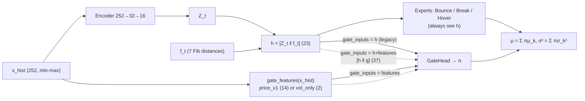
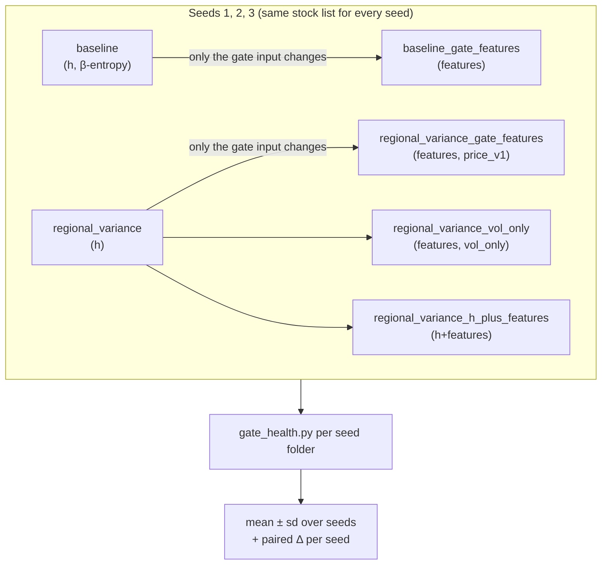
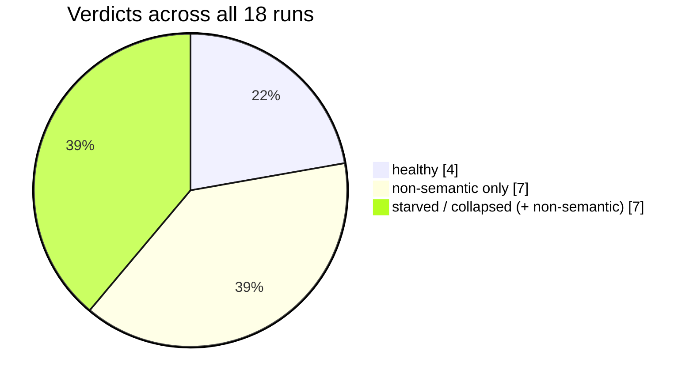
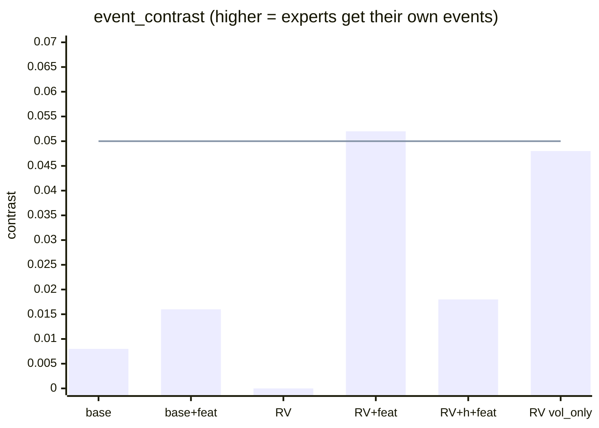
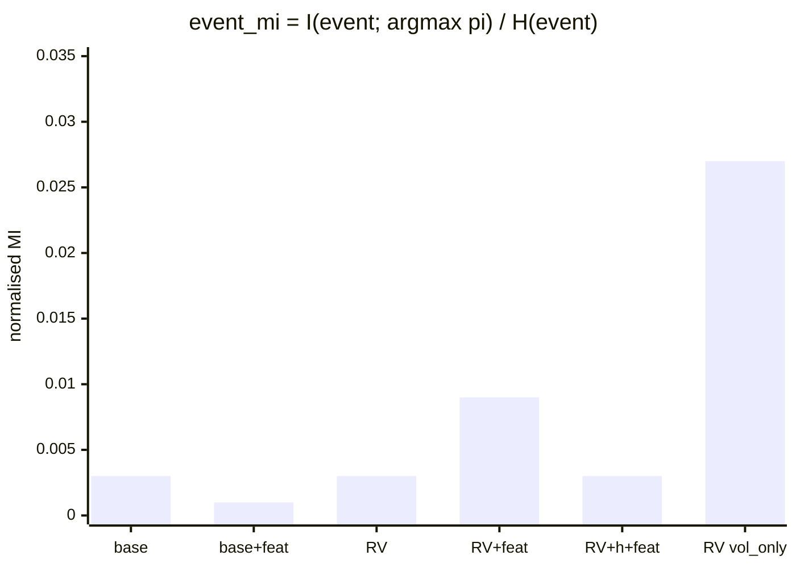
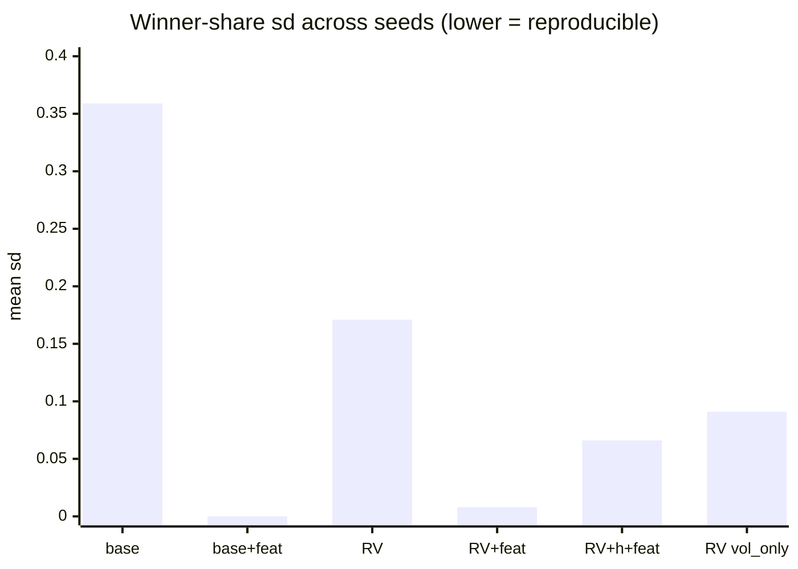
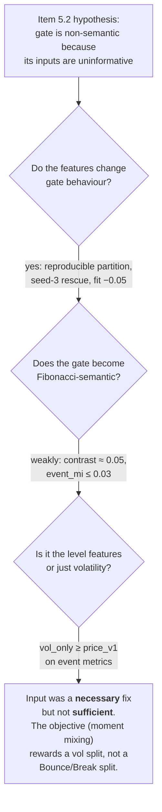
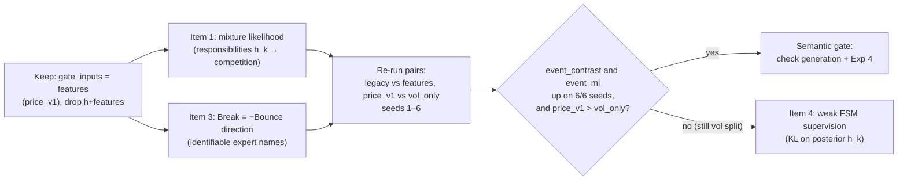

# Gate-input features (study item 5.2): benchmark results and analysis

Study notes, 2026-11-08. These notes cover the "Gate-input variants" cell in `fibonacci_neural_sde/experiments/neural_SDE/gate_collapse_benchmark.ipynb`, on branch `feat/gate-input-features`: 6 variants, seeds 1–3, one fixed list of stocks, and checkpoints chosen on `val/loss_sde`. The metrics come from `gate_health.py`, run on each `gate_inputs_<stamp>/seed_N` folder. Background is in [fibonacci_neural_sde_gating.md](fibonacci_neural_sde_gating.md).

## TL;DR

1. **Gate features without a regulariser** (`baseline_gate_features`):
   - `val_loss_sde` improves on **all 3 seeds** (Δ = −0.051 ± 0.014).
   - The gate does not route. On every real window its argmax is Hover, in all 3 seeds, so it acts as a soft, volatility-driven σ interpolator.
   - It is no more semantic than before.
2. **Gate features with `regional_variance`** (`regional_variance_gate_features`):
   - It is the only gate that is **reproducible across seeds**. Winner shares vary by about 0.01 between seeds; the legacy gate varies by 0.1–0.2.
   - It fixes the seed-3 starvation of `regional_variance`.
   - It raises `event_contrast` from 0.000 to 0.052, which passes the "semantic" threshold on 2 of 3 seeds.
   - Fit does not change.
   - Event alignment is still tiny in absolute terms: `event_mi` = 0.009.
3. **The `vol_only` ablation matches or beats the full feature set on event alignment**:
   - `event_mi` is 0.027 vs 0.009, it rises over `regional_variance` on 3 of 3 seeds, and the verdicts are the same.
   - So the event alignment the gate gains is a **volatility-regime alignment**. Level distances, approach, velocity and dwell add nothing the gate visibly uses.
   - The other 12 features buy fit and stability, not semantics.
4. **`h+features` is no better than `regional_variance`.** Given `h`, the gate keeps using the encoder path. Keep the gate on features only.
5. **Conclusion:** better inputs made the gate *stable* but not *Fibonacci-semantic*. The bottleneck has moved from the inputs to the **objective**. Moment mixing gives the gate no reason to separate Bounce from Break. The next change is the mixture likelihood together with the Break redefinition (catalogue items 1 and 3), keeping the features-only gate.

## 1. Background

### 1.1 The problem item 5.2 addresses

The MoE Neural SDE mixes three experts (Bounce, Break, Hover) through a gate `π = softmax(logits/T)`. The earlier study found the gate **non-semantic**: what it outputs has almost nothing to do with the Fibonacci events (bounce, breakout, hover) detected on real prices.

Root cause G1 is that the gate's input `h = [Z_t ‖ f_t]` contains nothing new. The 7 Fibonacci features are `pos_in_range − r_k`, which is a single number already in the price window.

Item 5.2 gives the gate **its own causal features** (`price_v1`, 14 values) and leaves the experts on `h`:

| Group | Features | Intended signal |
|---|---|---|
| Level distance | `dist_vol_0..6` = (x_t − l_k)/σ20, clipped to ±5 | How many "typical daily moves" away each level is |
| Approach | −sign(x_t − L\*)·sign(Δx_t) | Moving toward (+1) or away from (−1) the nearest level |
| Velocity | `vel_1`, `vel_5`, `vel_10` in σ20·√k units | Momentum: separates a breakout from a hover |
| Vol regime | log(σ20/σ60) | Volatility expanding or contracting |
| Range/vol | log(δ/(σ20·√252)) | Trending range vs noisy range |
| Dwell | `zone_days`: consecutive days within ±2% of L\*, divided by 20 | A causal version of the FSM hover state |

`vol_only` keeps just the two volatility features. It is the ablation from `improving-gating.md` that detects "the gate only routes on volatility".

### 1.2 The three gate-input modes

### 1.3 Experimental design

Every arrow is a **paired comparison**: same seed, same stocks, same split, one change. Paired Δs cancel most of the seed-to-seed variation, which is about 0.07–0.09 in absolute `val_loss_sde`.

### 1.4 How to read the metrics

| Metric | Meaning | Good direction | Note |
|---|---|---|---|
| `val_loss_sde` | One-step Gaussian NLL on the validation split, without the regulariser term | lower | The only fair fit comparison |
| `val_mi_input_expert` | H(π̄)/log3 − mean H(π): how much π depends on the input | higher, but not the goal | `regional_variance` pushes this to ~1 by construction |
| `val_entropy` | Mean normalised entropy of π | neither | ≈1 is uniform, ≈0 is confident |
| `event_mi` | I(FSM event; argmax π)/H(event) on real 2018–2020 windows | higher | **Ignores expert names**: any consistent partition scores |
| `event_contrast` | Mean over experts of π_k on its own events minus π_k on other events | higher, > 0.05 | **Checks names**: Bounce events must go to Bounce |
| `real_win_*` | Share of real windows where an expert is the argmax | each ≥ 0.1 | Shows collapse and starvation |
| `verdict` | `hard-collapse` (max val win ≥ 0.95), `starved-expert` (min < 0.02), `uniform-soft`, `non-semantic` (contrast < 0.05), `healthy` | `healthy` | Heuristic thresholds |

## 2. Results

### 2.1 Summary over seeds (mean ± sd, n = 3)

| Variant | `val_loss_sde` | `mi_input` | `entropy` | `event_mi` | `event_contrast` | win B / Br / H |
|---|---|---|---|---|---|---|
| baseline | −2.470 ± 0.087 | 0.027 ± 0.019 | 0.882 ± 0.088 | 0.003 ± 0.003 | 0.008 ± 0.002 | 0.12 / 0.38 / 0.50 (sd 0.21 / 0.42 / 0.44) |
| baseline_gate_features | **−2.521** ± 0.094 | 0.049 ± 0.035 | 0.607 ± 0.319 | 0.001 ± 0.001 | 0.016 ± 0.006 | **0.00 / 0.00 / 1.00** (sd 0) |
| regional_variance | −2.478 ± 0.072 | 0.857 ± 0.216 | 0.012 ± 0.012 | 0.003 ± 0.001 | 0.000 ± 0.037 | 0.33 / 0.41 / 0.26 (sd 0.09 / 0.20 / 0.23) |
| regional_variance_gate_features | −2.500 ± 0.082 | **0.978 ± 0.009** | 0.021 ± 0.010 | 0.009 ± 0.009 | **0.052** ± 0.017 | 0.34 / 0.40 / 0.26 (**sd 0.01 / 0.01 / 0.00**) |
| regional_variance_h_plus_features | −2.464 ± 0.064 | 0.974 ± 0.022 | 0.025 ± 0.022 | 0.003 ± 0.001 | 0.018 ± 0.039 | 0.36 / 0.33 / 0.31 (sd 0.04 / 0.07 / 0.09) |
| regional_variance_vol_only | −2.308 ± 0.288 | 0.925 ± 0.077 | 0.060 ± 0.086 | **0.027** ± 0.005 | 0.048 ± 0.101 | 0.37 / 0.36 / 0.27 (sd 0.04 / 0.12 / 0.12) |

### 2.2 Verdicts per seed

| Variant | seed 1 | seed 2 | seed 3 |
|---|---|---|---|
| baseline | starved, uniform-soft, non-semantic | uniform-soft, non-semantic | hard-collapse, non-semantic |
| baseline_gate_features | starved, non-semantic | starved, non-semantic | hard-collapse, non-semantic |
| regional_variance | non-semantic | non-semantic | starved, non-semantic |
| regional_variance_gate_features | ✅ healthy | ✅ healthy | non-semantic |
| regional_variance_h_plus_features | non-semantic | non-semantic | non-semantic |
| regional_variance_vol_only | ✅ healthy | ✅ healthy | non-semantic |

### 2.3 Visual comparison

`event_contrast` (mean over 3 seeds). The line marks the 0.05 "semantic" threshold:

`event_mi` (mean over 3 seeds). `vol_only` stands out:

Reproducibility: the mean across experts of the between-seed sd of the real winner shares. Lower means the gate finds the same partition on every seed. `base+feat` is 0 only because it is always Hover.

### 2.4 Paired differences (variant − reference, same seed)

| Pair | metric | seed 1 | seed 2 | seed 3 | mean ± sd | sign 3/3? | paired t (df 2) |
|---|---|---|---|---|---|---|---|
| base+feat − base | `val_loss_sde` | −0.057 | −0.035 | −0.061 | **−0.051 ± 0.014** | ✅ better | t ≈ −6.3, p ≈ 0.02 |
| | `event_mi` | −0.005 | −0.002 | 0.000 | −0.002 ± 0.003 | ✗ | — |
| | `event_contrast` | +0.005 | +0.015 | +0.003 | +0.008 ± 0.006 | ✅ (tiny) | p ≈ 0.15 |
| RV+feat − RV | `val_loss_sde` | −0.063 | +0.036 | −0.041 | −0.023 ± 0.052 | ✗ | p ≈ 0.5 |
| | `mi_input` | −0.001 | −0.005 | +0.369 | +0.121 ± 0.215 | — (seed-3 rescue) | — |
| | `event_mi` | +0.014 | +0.002 | 0.000 | +0.006 ± 0.008 | ≥ 0 on 3/3 | p ≈ 0.3 |
| | `event_contrast` | +0.057 | +0.094 | +0.004 | **+0.051 ± 0.045** | ✅ | p ≈ 0.19 |
| vol_only − RV | `val_loss_sde` | +0.042 | **+0.477** | −0.011 | +0.169 ± 0.268 | ✗ (seed 2 broke) | p ≈ 0.4 |
| | `event_mi` | +0.016 | +0.028 | +0.027 | **+0.024 ± 0.007** | ✅ | t ≈ 5.9, p ≈ 0.03 |
| | `event_contrast` | +0.073 | +0.166 | −0.097 | +0.047 ± 0.134 | ✗ | — |
| h+feat − RV | `val_loss_sde` | −0.017 | +0.043 | +0.014 | +0.013 ± 0.030 | ✗ | p ≈ 0.5 |
| | `event_mi` | −0.003 | −0.001 | +0.003 | 0.000 ± 0.003 | ✗ | — |
| | `event_contrast` | −0.039 | +0.080 | +0.011 | +0.018 ± 0.060 | ✗ | — |

The t-tests were computed from the rounded table values with n = 3, so they are only indicative. With 3 seeds a "3/3 same sign" result has a sign-test p of 0.25 (two-sided), so it is a direction, not significance.

## 3. Analysis

### 3.1 Gate features alone: better fit, but no routing

`baseline_gate_features` fits better than `baseline` on every seed (−0.051 NLL, with a paired sd only a quarter of the effect). Yet its argmax is Hover on **100% of real windows in all 3 seeds**. The validation verdicts show starved or collapsed experts too.

These two facts fit together as follows:

Under moment mixing, the cheapest way to lower the NLL is to make σ follow the current volatility regime. The new vol features hand the gate that information directly, so the gate turns into a **σ regressor**. It moves weight between the small-σ Hover expert and the larger-σ experts without ever changing which expert is on top.

This is the failure mode `improving-gating.md` §1 predicted (and Weigend et al. 1995 observed): with no competitive objective, the partition follows volatility. It also confirms the earlier diagnosis that under moment mixing the gate gradient is dominated by σ.

The fit gain is real, but it comes from **better conditional variance, not from regime routing**. The paper's interpretability claim does not benefit.

### 3.2 With `regional_variance`: stable, mildly aligned

`regional_variance` forces confident, diverse routing (`mi_input` ≈ 1, entropy ≈ 0.01). On the legacy input, *which* partition it finds depends on the seed: winner-share sd is 0.09–0.23, and seed 3 starves an expert (`mi_input` ≈ 0.61 on that seed).

With the gate features:
- **Reproducibility.** The winner shares are 0.337 / 0.401 / 0.262 with sd ≤ 0.011, and `mi_input` is 0.978 ± 0.009. Every seed lands on essentially the same partition, which means the partition is anchored to the input features rather than to arbitrary encoder directions. This is the clearest positive result of the experiment.
- **Semantics.** `event_contrast` rises on all 3 seeds (+0.051 on average) and passes the 0.05 threshold on seeds 1 and 2, giving the two `healthy` verdicts. But `event_mi` is only 0.009: the argmax explains about 1% of the event entropy. The gate's probabilities *lean* toward the right expert, but the hard assignment barely tracks events.
- **Fit.** No change (−0.023 ± 0.052, with mixed signs).

So the features give `regional_variance` something sensible to split on. The split is consistent, but it is only weakly the Fibonacci split.

### 3.3 The volatility ablation: alignment comes from volatility

If level distance, approach, velocity and dwell carried the event information, `vol_only` (2 features) should do clearly worse than `price_v1` (14 features) on event metrics. It does not:

| | `price_v1` gate | `vol_only` gate |
|---|---|---|
| `event_mi` | 0.009 ± 0.009 | **0.027 ± 0.005** (3/3 up vs RV) |
| `event_contrast` | 0.052 ± 0.017 | 0.048 ± 0.101 |
| verdicts | healthy, healthy, non-semantic | healthy, healthy, non-semantic |
| `val_loss_sde` | −2.500 ± 0.082 | −2.308 ± 0.288 (seed 2 +0.48) |

This matches the probe run before the benchmark. There, a classifier on `price_v1` reached 0.370 balanced accuracy and one on `vol_only` reached 0.367, with chance at 0.333. Almost all of the event information available causally is in the two volatility features. Breakouts tend to come in expanding, high-vol windows, and hovers in contracting, low-vol windows.

Two further points:
- **Why `vol_only` has *higher* `event_mi` than `price_v1`.** With only volatility to work from, `regional_variance` has to split on volatility, and that split happens to correlate with events. With 14 features, the same regulariser can find other confident splits, using distance or velocity, that are just as "diverse" but unrelated to events. More inputs give the regulariser more freedom to be confidently arbitrary.
- **`event_mi` and `event_contrast` disagree for `vol_only` on seed 3** (MI +0.027, contrast −0.097). MI ignores labels: a gate that separates events but sends breakouts to the *Hover* slot still scores. Contrast checks names. Under moment mixing the expert names only come from the parametric drift signs, and since Bounce and Break agree in sign on 45.7% of windows (G12), the gate can attach a volatility cluster to any expert. Here is the identifiability problem in miniature.

The 12 non-volatility features **do** help fit and training stability: `vol_only` has the worst and most variable loss, and seed 2 broke. They do not help semantics as far as these metrics can see.

### 3.4 `h+features`: the encoder path dilutes the features

`h+features` behaves like plain `regional_variance`:
- non-semantic on all seeds;
- `event_mi` Δ 0.000;
- winner-share sd 0.04–0.09.

Its only benefit is the seed-3 rescue of `mi_input`. When the gate gets the 23 `h` dimensions as well, it routes mainly on them. This supports the design in `improving-gating.md` §2: **restrict the regime variables to the gate**, and do not concatenate them onto the encoder state.

### 3.5 Hypothesis check

## 4. Caveats

- **n = 3 seeds.** Only two results pass a paired t-test at about p < 0.05: the fit gain of `baseline_gate_features` and the `event_mi` gain of `vol_only`. Both rest on rounded values and df = 2. Everything else is a direction. Six seeds would allow a sign or Wilcoxon test (6/6 gives p ≈ 0.03).
- **The `healthy` verdict sits on a threshold.** `event_contrast` > 0.05 is a heuristic. `regional_variance_gate_features` passes on seeds 1 and 2 at about 0.05–0.09 and fails on seed 3, so "2/3 healthy" overstates how different the variants are.
- **Event metrics are small by construction.** The FSM labels cover about 3% of windows and need 9 days of hindsight. A causal gate cannot see the outcome of a breakout, so even an ideal gate would have a modest `event_mi`. Compare variants with each other, not with 1.0.
- **In-sample.** The validation split is random, not time-based, and the Exp 2 windows (2018–2020) overlap training. These numbers rank variants. They are not out-of-sample evidence.
- **Loss comparability.** The comparison uses `val_loss_sde`, which excludes the regulariser term, so baseline and `regional_variance` variants are compared fairly. The `vol_only` seed-2 run (+0.48) looks like a failed run, for example an early-stop on a bad epoch. Check its `epoch_metrics.csv` before reading anything into it.
- **Not covered:** generation fidelity (MC paths and `Statistical_comparison.ipynb`) and Exp 4 temporal statistics. Note also that `generate_samples` ignores the trained temperature (G7).

## 5. Recommendations

1. **Adopt the features-only gate as the new default for further experiments.** Use `price_v1` rather than `vol_only`: same semantics, better and more stable fit. Drop `h+features`.
2. **Change the objective next** (catalogue item 1, mixture NLL). It turns the gate gradient into `π_k − h_k`, which rewards the expert that actually explains the next move. Without that, any regulariser just picks some confident partition, and the inputs make it a volatility partition.
3. **Make the expert names identifiable** (item 3, Break as continuation through the level). This is needed before `event_contrast` can rise much, given the 45.7% Bounce/Break sign agreement.
4. **Keep the `vol_only` ablation in every future benchmark.** The real test of "Fibonacci-semantic" is `price_v1` **beating** `vol_only` on `event_contrast` and `event_mi`, not just beating the legacy gate.
5. **Extend to 6 seeds** for the pairs that matter, `regional_variance` vs `regional_variance_gate_features` and `regional_variance_gate_features` vs `regional_variance_vol_only`. Finished variants are skipped, so only seeds 4–6 need to run.
6. If the mixture likelihood still produces a volatility split, but the probe shows the labels are predictable (it does, a little: 0.37 vs 0.33), add **weak FSM supervision** (item 4).
7. Open the `vol_only` seed-2 `epoch_metrics.csv` to confirm the +0.48 loss is a broken run, not instability caused by the feature set.
