# The Fibonacci Neural SDE and its gating problem: a walkthrough

This document explains one research project from start to finish: a model that generates synthetic stock prices, the part of that model that does not work as intended (the *gate*), the methods tried to repair it, and what the experiments showed.

It is built from two sets of study notes ([fibonacci_neural_sde_gating.md](fibonacci_neural_sde_gating.md) and [gate_input_features_results.md](gate_input_features_results.md)), the code in the `fibonacci_neural_sde` repository (branch `feat/gate-input-features`), and the saved benchmark outputs. All code paths below are relative to that repository's root.

**The one-paragraph version.** The model mixes three "experts", named Bounce, Break and Hover, to predict how a stock price moves near Fibonacci retracement levels. A gate decides how much each expert counts. The paper claims the gate is interpretable: it should say "this is a bounce" when the price is bouncing. In practice it does not. Two rounds of experiments tried to fix this. Changing the regulariser stopped the gate from collapsing but did not make it meaningful. Giving the gate better inputs made it stable and reproducible across random seeds, but what it learned to follow is volatility, not Fibonacci events. The remaining obstacle is the training objective itself.

## Contents

1. [Glossary](#1-glossary)
2. [The problem](#2-the-problem)
3. [Anatomy of the model](#3-anatomy-of-the-model)
4. [Why the gate fails](#4-why-the-gate-fails)
5. [Methods applied](#5-methods-applied)
6. [How the gate is measured](#6-how-the-gate-is-measured)
7. [Experiment A: regulariser benchmark](#7-experiment-a-regulariser-benchmark)
8. [Experiment B: gate-input features](#8-experiment-b-gate-input-features)
9. [What the experiments establish](#9-what-the-experiments-establish)
10. [Limitations](#10-limitations)
11. [Next steps](#11-next-steps)
12. [Where things live](#12-where-things-live)

---

## 1. Glossary

### Abbreviations

| Abbreviation | Stands for | Meaning here |
|---|---|---|
| SDE | Stochastic differential equation | An equation for a quantity that changes by a predictable part (drift) plus a random part (diffusion) |
| Neural SDE | — | An SDE whose drift and diffusion are produced by neural networks |
| MoE | Mixture of experts | Several small networks (experts) whose outputs are combined using weights from another network (the gate) |
| MLP | Multilayer perceptron | A plain feed-forward neural network |
| NLL | Negative log-likelihood | The training loss: how surprised the model is by the data. Lower is better |
| MDN | Mixture density network | A network that outputs a full mixture distribution, not one blended Gaussian |
| FSM | Finite-state machine | The rule-based detector that labels real price paths with bounce, breakout and hover events |
| MI | Mutual information | How much knowing one variable tells you about another. 0 means nothing |
| KL | Kullback–Leibler divergence | A measure of how far one probability distribution is from another |
| JS | Jensen–Shannon distance | A symmetric, bounded measure of distance between two distributions |
| TSTR | Train on synthetic, test on real | A test of synthetic data: train a classifier on it and check it on real data |
| OU | Ornstein–Uhlenbeck process | A simple mean-reverting SDE. The Vasicek model is the same process, used here as the baseline generator |
| MC | Monte Carlo | Generating many random sample paths |
| LN | Layer normalisation | Rescales a layer's activations to zero mean and unit variance |
| ReLU | Rectified linear unit | Activation $\max(0, a)$ |
| SiLU | Sigmoid linear unit (Swish) | Activation $a \cdot \text{sigmoid}(a)$ |
| SwiGLU | Swish-gated linear unit | A layer that multiplies a SiLU-activated projection by a second, linear projection |
| RV | Regional variance | One of the gate regularisers (section 5.4). In chart labels, "RV" means a run trained with it |
| Exp 1, 2, 4 | Experiments 1, 2, 4 | The three diagnostic tools (section 6). There is no Exp 3 |
| B / Br / H | Bounce / Break / Hover | The three experts, in that order (indices 0, 1, 2) |
| sd | Standard deviation | — |
| df | Degrees of freedom | For the paired t-tests, number of seeds minus one |
| vol | Volatility | The typical size of daily price moves |
| nat | — | The unit of information or log-likelihood when using natural logarithms |

### Symbols

| Symbol | Meaning |
|---|---|
| $P_t$ | Raw stock price on day $t$ |
| $x_t$ | Price after scaling the 252-day window to the range 0 to 1 |
| $x_{\text{hist}}$ | The scaled 252-day window ending at day $t$ |
| $\Delta x$ | Next-day move, $x_{t+1} - x_t$ |
| $\delta$ | Range of the window, high minus low. In scaled units $\delta = 1$ |
| $r_k$ | The 7 Fibonacci ratios: 0, 0.236, 0.382, 0.5, 0.618, 0.786, 1 |
| $L_k$ | Fibonacci level $k$: low $+\ r_k \delta$ |
| $L^\ast$ | The level nearest to the current price |
| $f_t$ | The 7 Fibonacci features, $(x_t - L_k)/\delta$ |
| $Z_t$ | The encoder's 16-number summary of the window |
| $h$ | The shared input $[Z_t \,\Vert\, f_t]$, 23 numbers. $\Vert$ means concatenation |
| $g_t$ | Gate-only features (14 for `price_v1`, 2 for `vol_only`) |
| $z$ | The gate's 3 raw output scores (logits) |
| $\pi = (\pi_1, \pi_2, \pi_3)$ | Gate weights for Bounce, Break, Hover. They are positive and sum to 1 |
| $\mu_k, \sigma_k$ | Drift and volatility proposed by expert $k$ |
| $\mu, \sigma$ | The blended drift and volatility the model actually uses |
| $K$ | Number of experts, 3 |
| $B$ | Batch size |
| $\bar p_k$ | Average of $\pi_k$ over a batch: how much expert $k$ is used overall |
| $H(p)$ | Entropy, $-\sum_k p_k \log p_k$. Highest ($\log 3$) when $p$ is uniform, 0 when one entry is 1 |
| $\beta$ | Strength of the gate regulariser |
| $\lambda$ | Strength of the balance loss |
| $T$ | Softmax temperature. High $T$ flattens $\pi$, low $T$ sharpens it |
| $\sigma_{20}, \sigma_{60}$ | Standard deviation of daily moves over the last 20 and 60 days |

---

## 2. The problem

### 2.1 What the paper sets out to do

The paper is *Synthetic Stock Data via a Mixture of Experts Neural SDE: Modeling Fibonacci Levels* (Javid & Molavipour). Its goal is a generator of **synthetic daily stock price paths** that look and behave like real ones. Synthetic paths are useful when real history is too short to train or test other models on.

The paper's particular idea is to build a piece of trader folklore into the generator. Many traders watch **Fibonacci retracement levels**: take the lowest and highest price of the past year, and draw horizontal lines at fixed fractions of that range (0%, 23.6%, 38.2%, 50%, 61.8%, 78.6%, 100%). Prices are said to do one of three things when they reach such a line:

| Behaviour | What happens | Trading term |
|---|---|---|
| **Bounce** | The price turns back from the level | Support or resistance holds |
| **Break** | The price pushes through the level and keeps going | Breakout, momentum |
| **Hover** | The price stays close to the level, moving little | Consolidation |

The model has one expert per behaviour, and a gate that chooses between them.

### 2.2 Background: SDEs in one minute

An SDE describes a quantity $X$ that changes a little at each instant:

$$dX_t = \mu \, dt + \sigma \, dW_t$$

- $\mu$ is the **drift**: the direction the price is expected to move.
- $\sigma$ is the **diffusion** or volatility: how large the random part is.
- $dW_t$ is random noise.

On a computer, time moves in steps. The **Euler–Maruyama** scheme turns the SDE into a daily update, with a time step of one day:

$$x_{t+1} = x_t + \mu + \sigma \, \varepsilon_t, \qquad \varepsilon_t \sim \mathcal{N}(0, 1)$$

In a Neural SDE, $\mu$ and $\sigma$ are outputs of neural networks that look at the recent price history. Read this way, the model is a statement about tomorrow: *given the last 252 days, tomorrow's move is Gaussian with mean $\mu$ and standard deviation $\sigma$.*

### 2.3 Background: mixture of experts

A mixture of experts splits a prediction problem among several small networks. A separate network, the **gate**, looks at the input and outputs one weight per expert. The idea, going back to Jacobs, Jordan, Nowlan and Hinton (1991), is that each expert ends up specialising in one region of the input space, and the gate learns which region each input belongs to.

Whether that specialisation happens depends on the training objective, which is the central point of section 4.

### 2.4 The claim under test

The paper presents the gate as **interpretable**. If the gate puts weight 0.9 on Bounce, you should be able to read that as "the model thinks this is a bounce situation". This document calls a gate that behaves this way **semantic**.

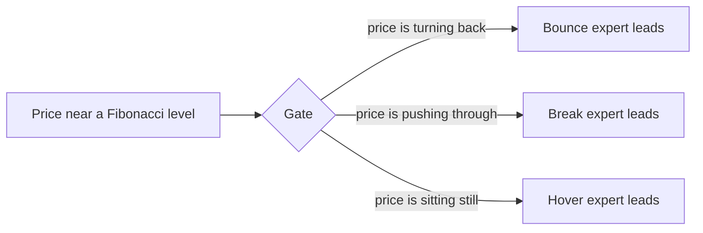

**The gating problem** is that the trained gate does not do this. Depending on settings, it either ignores two of the experts, or gives all three about one third each, or makes confident choices that have nothing to do with bounces and breakouts. In every variant tested, the gate's choice carries about 1% or less of the information about which event is happening.

---

## 3. Anatomy of the model

### 3.1 From raw prices to model inputs

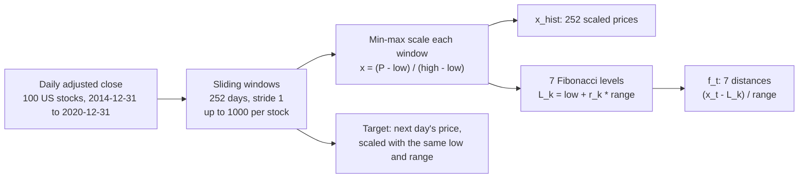

Each training example is one window of 252 trading days (about one year) and the price on the following day. The window is rescaled so that its lowest price is 0 and its highest is 1. The next-day target is scaled with the same low and range, so it can fall slightly outside 0 to 1.

The Fibonacci features are the signed distances from today's price to each of the 7 levels, as a fraction of the range:

$$f_{t,k} = \frac{x_t - L_k}{\delta}, \qquad L_k = \text{low} + r_k\,\delta$$

Code: `amgm/data/neural_SDE.py` (`_min_max_normalize`, `calculate_features`). The data is split 80/20 at random into training and validation windows.

### 3.2 The whole model

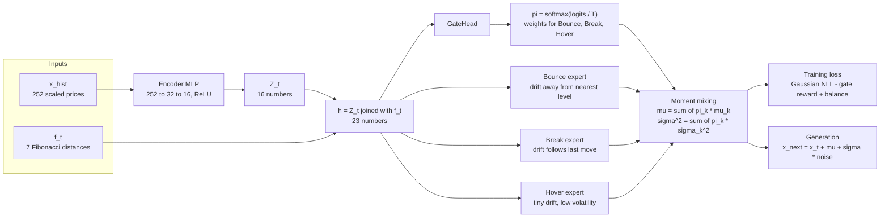

Three things to notice:

1. An **encoder** compresses the 252 prices into 16 numbers, $Z_t$.
2. $Z_t$ and the 7 Fibonacci features are joined into one vector $h$. In the original design **the gate and all experts read the same $h$**.
3. The experts' outputs are blended into **one** drift and **one** volatility before the loss is computed.

Code: `NeuralSDEMoE` in `amgm/models/mlp.py`.

### 3.3 The three experts

Each expert has two small heads (23 → 32 → 1, with layer normalisation and SiLU): one for drift and one for volatility. What makes an expert a "Bounce" or a "Break" expert is a **hard-wired sign** on its drift. The network only decides the size.

| Expert | Drift $\mu_k$ | Volatility $\sigma_k$ | Built-in behaviour |
|---|---|---|---|
| Bounce | $s_B \cdot \text{softplus}(m_B(h))$ with $s_B = \text{sign}(x_t - L^\ast)$ | $\text{softplus}(v_B(h)) + 0.001$ | Pushes the price **away from the nearest level**: up if the price is above it, down if below |
| Break | $s_K \cdot \text{softplus}(m_K(h))$ with $s_K = \text{sign}(x_t - x_{t-1})$ | $\text{softplus}(v_K(h)) + 0.001$ | Pushes the price in the **direction of yesterday's move** |
| Hover | $0.05 \cdot \tanh(m_H(h))$ | $0.001 + 0.02 \cdot \text{sigmoid}(v_H(h))$ | Drift capped at ±0.05, volatility capped between 0.001 and 0.021 |

Here $m_k$ and $v_k$ are the expert's drift and volatility heads. $\text{softplus}(a) = \log(1 + e^a)$ is always positive, so the sign of the drift is fixed entirely by $s_B$ or $s_K$.

Hover is the only expert whose volatility is tightly bounded. That detail matters later.

### 3.4 The gate, in detail

The gate is the network `GateHead`. It takes an input vector $u$ (originally $u = h$) and returns three weights.

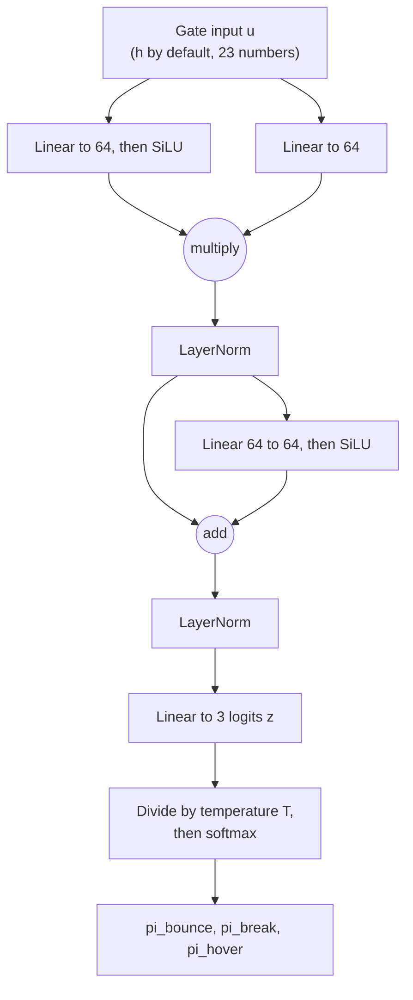

Step by step:

**1. SwiGLU interaction.** Two linear projections of the input are multiplied together, one of them passed through SiLU first. This lets the gate model interactions between inputs (for example "close to a level *and* moving fast").

$$a = \text{SiLU}(W_g u + b_g) \odot (W_v u + b_v)$$

**2. Normalise.**

$$a' = \text{LN}(a)$$

**3. Residual block, then normalise again.**

$$a'' = \text{LN}\big(a' + \text{SiLU}(W_o a' + b_o)\big)$$

**4. Project to three scores**, one per expert. These are called logits.

$$z = W_p a'' + b_p \in \mathbb{R}^3$$

**5. Tempered softmax** turns the scores into weights that are positive and sum to 1.

$$\pi_k = \frac{\exp(z_k / T)}{\sum_{j=1}^{3} \exp(z_j / T)}$$

The temperature $T$ controls sharpness. At $T = 5$, differences between scores are shrunk and $\pi$ is close to uniform. At $T = 0.5$, differences are doubled and $\pi$ is close to picking one expert.

Two properties of this design:

- **Routing is dense and soft.** Every expert always contributes. There is no hard choice and no sampling.
- **The gate has no memory.** It is evaluated separately for every window, so nothing ties today's weights to yesterday's.

### 3.5 Moment mixing

The gate's weights blend the experts' outputs:

$$\mu = \sum_{k=1}^{3} \pi_k\,\mu_k \qquad\qquad \sigma^2 = \sum_{k=1}^{3} \pi_k\,\sigma_k^2$$

The result is a **single Gaussian** for tomorrow's move. This is called *moment mixing* because it mixes the first two moments (mean and variance) of the experts' predictions.

It is not the same as a true mixture distribution. A true mixture says "with probability $\pi_k$, tomorrow's move comes from expert $k$'s Gaussian", which gives a density with up to three bumps:

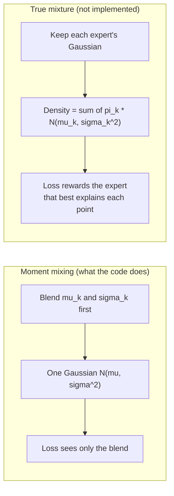

The difference decides whether experts specialise, as section 4.2 explains.

### 3.6 The training objective

**The fit term** is the one-step Gaussian negative log-likelihood of the observed move, with the constant dropped:

$$L_{\text{SDE}} = \text{mean over batch of}\quad \tfrac{1}{2}\left[\log \sigma^2 + \frac{(\Delta x - \mu)^2}{\sigma^2}\right]$$

A useful sanity check: the trained models have $\sigma \approx 0.047$ in scaled units, so $\tfrac12 \log \sigma^2 \approx -3.06$, and the second term averages about $0.5$ for a calibrated model. That gives about $-2.56$, which is why the reported losses are negative numbers around $-2.4$ to $-2.6$.

**The total loss** adds two terms that act only on the gate:

$$L = L_{\text{SDE}} \;-\; R(\pi;\beta) \;+\; \lambda\,L_{\text{bal}}$$

- $R(\pi; \beta)$ is a **reward** for "good" gate behaviour. It is subtracted, so a larger reward lowers the loss. Section 5 covers the different choices of $R$.
- $L_{\text{bal}} = \sum_k (\bar p_k - \tfrac13)^2$ is a **balance penalty**: it is zero when all three experts are used equally on average.

Because $R$ differs between variants, the total loss cannot be compared across them. **Fit is always compared on $L_{\text{SDE}}$ alone**, reported as `val_loss_sde`.

Code: `_step_nll` and `_compute_loss` in `amgm/models/neural_SDE/runner.py`. Training uses the Adam optimiser, learning rate 0.001, batch size 256, 20 epochs.

### 3.7 Generating a synthetic path


The model is run forward one day at a time, feeding its own output back in. Code: `_rollout_sde` in `experiments/neural_SDE/generate_samples.py`.

---

## 4. Why the gate fails

### 4.1 Four ways a gate can be unhealthy

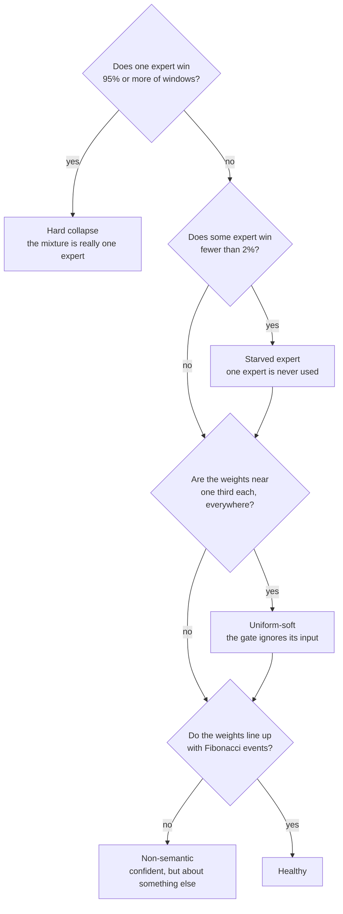

| Pattern | What it looks like | Why it is a problem |
|---|---|---|
| **Hard collapse** | One expert has almost all the weight. Early baseline runs had Hover at $\pi \approx 0.96$ | Two experts are dead weight |
| **Starved expert** | One expert never wins. In the baseline, Bounce wins 0% of windows | Same, for one expert |
| **Uniform-soft** | $\pi \approx (\tfrac13, \tfrac13, \tfrac13)$ for every input | The gate carries no information |
| **Non-semantic** | Sharp, balanced routing that is unrelated to bounces, breaks and hovers | The gate is not interpretable in the way the paper claims |

The first three are forms of what the literature calls *gate collapse*. The fourth is subtler and is the one that remains after the others are fixed.

### 4.2 Five root causes

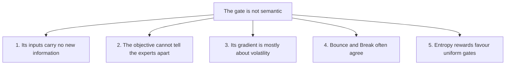

#### Cause 1: the Fibonacci features are one number, repeated

Substitute the definition of the levels into the feature:

$$f_{t,k} = \frac{x_t - L_k}{\delta} = \frac{x_t - \text{low} - r_k\,\delta}{\delta} = \underbrace{\frac{x_t - \text{low}}{\delta}}_{\text{position in range}} - \; r_k$$

All seven features are the **same number**, the price's position in its yearly range, minus seven fixed constants. In scaled units that position is simply $x_t$, the last entry of the window the encoder already reads. So the Fibonacci features give the gate nothing it did not already have. In particular, nothing tells the gate how *fast* the price is moving or how *volatile* it has been, which is what separates a bounce from a breakout.

#### Cause 2: moment mixing makes the weights unidentifiable

The loss only sees the blended $\mu$ and $\sigma$. Many different combinations of gate weights and expert outputs give the same blend. For the drift:

$$\underbrace{0.1}_{\pi_k} \times \underbrace{0.02}_{\mu_k} \;=\; \underbrace{0.5}_{\pi_k} \times \underbrace{0.004}_{\mu_k}$$

The loss cannot distinguish "the gate trusts this expert a little and the expert shouts" from "the gate trusts it a lot and the expert whispers". Nothing forces $\pi$ to mean anything.

A true mixture likelihood is different. There, each expert is scored on how well *it alone* explains each data point, and experts compete for points. Jacobs et al. (1991) showed that only this competitive form makes experts specialise.

#### Cause 3: the gate's learning signal is about volatility, not direction

Write the per-sample loss as $L = \tfrac12 \log \sigma^2 + \tfrac12 r^2/\sigma^2$ with residual $r = \Delta x - \mu$. Differentiating with respect to one gate weight gives:

$$\frac{\partial L}{\partial \pi_k} \;=\; \underbrace{\frac{1}{2}\,\frac{\sigma_k^2}{\sigma^2}\left(1 - \frac{r^2}{\sigma^2}\right)}_{\text{variance term}} \;-\; \underbrace{\frac{r\,\mu_k}{\sigma^2}}_{\text{drift term}}$$

- The **variance term** says: raise the weight of a high-volatility expert when the move was larger than expected, lower it when the move was smaller.
- The **drift term** says: raise the weight of an expert whose drift pointed the right way.

On daily stock data the drift is tiny next to the noise. In the trained models the average $\lvert\mu\rvert$ is 0.0004 to 0.0016 while $\sigma$ is about 0.047, so **drift is 1–3% of volatility**. The drift term is therefore swamped. Bounce versus Break is purely a statement about drift *direction*, so the gate gets almost no signal about it. What the gate can learn is "low volatility versus high volatility", and Hover, with its capped $\sigma$, is the one expert that stands out on that axis.

The gate therefore behaves as a **volatility selector**.

#### Cause 4: Bounce and Break push the same way almost half the time

Bounce pushes away from the nearest level. Break pushes in the direction of the last move. If the price is *already moving away* from the nearest level, both push the same way.

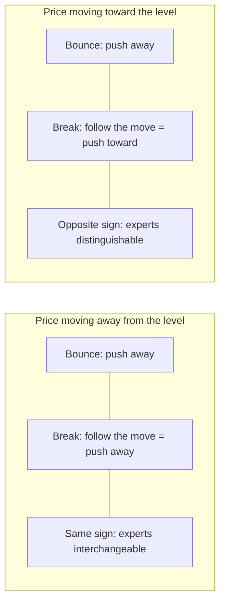

On real windows the two signs agree **45.7%** of the time. In those windows the two experts differ only in size, and by cause 2 size can be traded against gate weight.

#### Cause 5: the original regulariser asks for a uniform gate

The paper's regulariser rewards high entropy of $\pi$ for every sample. Entropy is highest when $\pi = (\tfrac13, \tfrac13, \tfrac13)$. So the regulariser's ideal gate is one that ignores its input completely. It was added to prevent collapse onto one expert, and it does discourage that, but it trades one failure (collapse) for another (uniform-soft).

---

## 5. Methods applied

Two families of fixes were tried. Sections 5.1 to 5.6 change the **regulariser** $R$ or the softmax temperature. Section 5.7 changes the gate's **inputs**.

Notation for this section: a batch has $B$ samples, $\pi_{b,k}$ is the weight of expert $k$ on sample $b$, and $\bar p_k = \tfrac1B \sum_b \pi_{b,k}$ is expert $k$'s average usage.

Code for 5.1–5.5: `amgm/models/neural_SDE/gate_regularizers.py`. Schedules: `amgm/models/neural_SDE/runner.py`.

### 5.1 Entropy reward (the paper's baseline)

**Purpose.** Stop the gate committing to one expert early in training, before the experts have learned anything.

**Definition.**

$$R_{\text{entropy}} = \beta \cdot \frac{1}{B}\sum_{b=1}^{B} H(\pi_b), \qquad H(\pi_b) = -\sum_{k=1}^{3} \pi_{b,k}\log \pi_{b,k}$$

**Schedule.** $\beta$ is held at 0.1 for 200 steps, then lowered along a cosine curve to 0.01 over 800 steps:

$$\beta(s) = \begin{cases} \beta_{\max} & s < s_w \\ \beta_{\min} + (\beta_{\max} - \beta_{\min})\cdot\tfrac12\left[1 + \cos\!\left(\pi\,\dfrac{s - s_w}{s_d}\right)\right] & s_w \le s < s_w + s_d \\ \beta_{\min} & \text{afterwards} \end{cases}$$

with step count $s$, warm-up length $s_w$ and decay length $s_d$.

**What it is maximised by.** A uniform gate on every sample (cause 5).

### 5.2 Adaptive entropy

**Purpose.** Rescue experts that are being starved, by making the entropy reward stronger for them.

**Definition.** Each expert gets its own coefficient, which grows when the expert is under-used:

$$R_{\text{adaptive}} = \frac{1}{B}\sum_{b=1}^{B}\sum_{k=1}^{3} \beta_k\,\big(-\pi_{b,k}\log \pi_{b,k}\big), \qquad \beta_k = \frac{\beta}{\text{clamp}\!\left(\bar p_k \,/\, \tfrac13,\; 0.1,\; 1\right)}$$

- An expert used at or above its fair share ($\bar p_k \ge \tfrac13$) gets $\beta_k = \beta$.
- An expert used at one tenth of its fair share or less gets $\beta_k = 10\beta$.
- $\bar p_k$ is treated as a constant when computing gradients, so the model cannot game the coefficient.

**What it is maximised by.** Still a near-uniform gate. It moves weight toward neglected experts but does not ask for confident routing.

### 5.3 Temperature annealing

**Purpose.** Let all experts receive gradient early (soft gate), then force the gate to commit (sharp gate).

**Background.** This is an optimisation device borrowed from simulated annealing and from discrete-choice relaxations such as Gumbel-softmax: start smooth, end sharp.

**Definition.** The softmax temperature in $\pi = \text{softmax}(z/T)$ follows the same warm-up-then-cosine schedule as $\beta$, from $T = 5$ down to $T = 0.5$ over 800 steps after a 200-step warm-up.

**Limitation.** The final linear layer of the gate can rescale its own outputs, so the network can undo any temperature. Annealing shapes the path of training. It does not change what the objective rewards.

### 5.4 Regional variance

**Purpose.** Reward the opposite of uniformity: the gate should give *different* weights to different inputs.

**Definition.** For each expert, take the variance of its weight across the batch, then average over experts:

$$R_{\text{RV}} = \beta \cdot \frac{1}{3}\sum_{k=1}^{3} \text{Var}_b\big(\pi_{b,k}\big), \qquad \text{Var}_b(\pi_{b,k}) = \frac{1}{B}\sum_{b=1}^{B}\big(\pi_{b,k} - \bar p_k\big)^2$$

**What it is maximised by.** If every sample gets the same $\pi$, the variance is 0. The variance is largest when each sample picks exactly one expert (one-hot routing) and the experts share the samples equally. In that case each $\pi_{b,k}$ is 1 for a third of the samples and 0 for the rest, a Bernoulli variable with probability $\tfrac13$:

$$\text{Var} = \tfrac13\left(1 - \tfrac13\right) = \tfrac29 \approx 0.222$$

The trained models reach 0.219–0.220, essentially the maximum.

**Settings used.** $\beta$ from 7 down to 1.5, balance $\lambda = 2$, and temperature annealing from 5 to 0.5.

**What it does not do.** It rewards *any* confident, balanced split of the inputs. It has no idea which split corresponds to bounces and breaks.

### 5.5 Balance loss

**Purpose.** Keep average usage equal across experts, so none is starved.

$$L_{\text{bal}} = \sum_{k=1}^{3}\left(\bar p_k - \tfrac13\right)^2$$

**Limitation.** A uniform gate also satisfies it perfectly. On its own it prevents starvation but not uniform-soft collapse. It is used together with regional variance, which supplies the pressure toward confident routing.

### 5.6 Mutual-information reward (implemented, never run)

$$R_{\text{MI}} = \beta\left[H(\bar p) - \frac{1}{B}\sum_{b=1}^{B} H(\pi_b)\right]$$

The first term is large when experts are used equally on average. The second is small when each sample's gate is confident. Their difference estimates the mutual information between input and chosen expert. It combines the goals of 5.4 and 5.5 in one expression and is bounded by $\log 3$. It exists in the code but has **no benchmark results**.

### 5.7 Gate-specific input features

**Purpose.** Address cause 1 directly: give the gate information that actually distinguishes a bounce from a break from a hover.

**Background.** Mixture-of-experts theory (Chen et al., 2022) says a gate can only route well if the regimes are separable *in the gate's own input space*. Jordan and Jacobs (1994) already noted that the gate's inputs need not be the experts' inputs.

**Design.** The gate receives its own feature vector $g_t$, computed from the price window. The experts keep reading $h$. Three modes are selectable with `gate_inputs`:

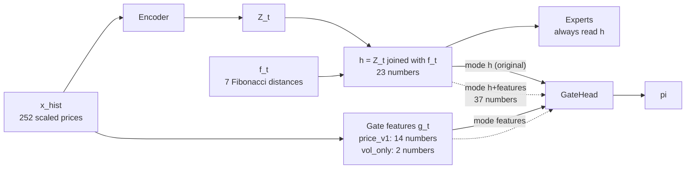

**The `price_v1` feature set (14 features).** All are *causal*: they use only prices up to today. Values are clipped to ±5.

| Group | Feature | Formula | What it tells the gate |
|---|---|---|---|
| Level distance (7) | `dist_vol_k` | $(x_t - L_k)\,/\,\sigma_{20}$ | How many typical daily moves away each level is |
| Approach (1) | `approach` | $-\text{sign}(x_t - L^\ast)\cdot\text{sign}(x_t - x_{t-1})$ | $+1$ if moving toward the nearest level, $-1$ if moving away |
| Velocity (3) | `vel_1`, `vel_5`, `vel_10` | $(x_t - x_{t-k})\,/\,(\sigma_{20}\sqrt{k})$ for $k = 1, 5, 10$ | Momentum over 1, 5 and 10 days, in volatility units |
| Volatility regime (1) | `log_vol_ratio` | $\log(\sigma_{20}/\sigma_{60})$ | Positive if volatility is expanding, negative if contracting |
| Range versus volatility (1) | `log_range_vol` | $\log\big(\delta\,/\,(\sigma_{20}\sqrt{252})\big)$ | Large for a trending year, small for a noisy one |
| Dwell (1) | `zone_days` | Consecutive days, ending today, within $0.02\,\delta$ of $L^\ast$, capped at 20, divided by 20 | How long the price has been sitting at the level |

Unlike $f_t$, the distance features are divided by recent volatility, not by the range. That restores the scale information that cause 1 showed was missing.

**The `vol_only` feature set (2 features).** Only `log_vol_ratio` and `log_range_vol`. This is a control, not a candidate. It answers one question: *if the gate is given nothing but volatility, does it do just as well?* If yes, then whatever the gate learned from `price_v1` was about volatility, not about Fibonacci levels.

Code: `amgm/models/neural_SDE/gate_features.py`.

### 5.8 Methods at a glance

| Method | What it changes | What it rewards | Expected failure |
|---|---|---|---|
| Entropy | Regulariser | Uniform gate per sample | Uniform-soft |
| Adaptive entropy | Regulariser | Uniform gate, more so for under-used experts | Uniform-soft |
| Temperature annealing | Softmax sharpness over time | Nothing new | Whatever the regulariser allows |
| Regional variance + balance | Regulariser | Confident, balanced routing | Non-semantic |
| Mutual information | Regulariser | Confident, balanced routing | Not tested |
| Gate features (`price_v1`) | Gate input | — | Routing on volatility only |
| Gate features (`vol_only`) | Gate input (control) | — | — |

---

## 6. How the gate is measured

### 6.1 Three diagnostic tools

| Tool | What it does | Main outputs |
|---|---|---|
| **Exp 1: training history** | During training, records the gate's weights on the validation set after every epoch | `epoch_metrics.csv`: entropy, confidence, mean weight and winner share per expert |
| **Exp 2: real trajectories** | Runs the trained gate along real 2018–2020 price paths, labels real events with the FSM, and compares | `real_gates.csv`, `events.csv`, `event_summary.csv` |
| **Exp 4: temporal consistency** | Measures how often the gate switches expert, how long it stays, and compares real against synthetic paths | Switch rates, dwell lengths, transition matrices |

Exp 4 exists as tooling. No Exp 4 output is saved for the runs covered here, so this document reports no Exp 4 results.

### 6.2 The event detector

Exp 2 needs ground-truth labels: where in a real price path did a bounce, a break or a hover actually happen? These come from a rule-based finite-state machine (`experiments/neural_SDE/fibonacci_state_detection.py`).

A price is "in the zone" of a level when it is within a tolerance of 0.02 (in scaled units) of it.

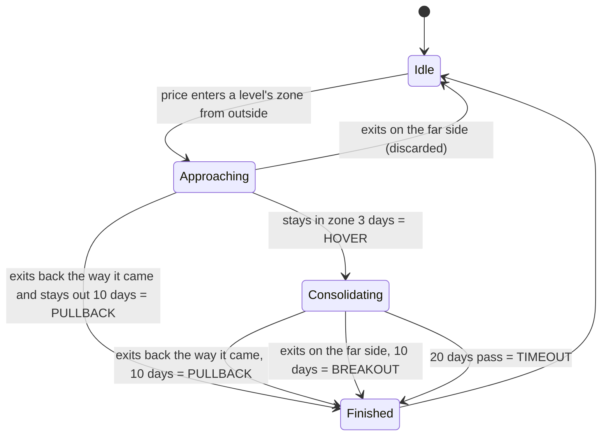

The detector's events map to experts as follows:

| FSM event | Expert label | Count in one run |
|---|---|---|
| Pullback | Bounce | 794 |
| Breakout | Break | 198 |
| Hover | Hover | 652 |

Two properties of these labels limit what any gate can score:

- **They are rare.** About 3% of windows carry a label.
- **Bounce and Break labels use hindsight.** A pullback or breakout is only confirmed after the price has stayed out of the zone for 10 days. The gate is read on the exit day and cannot see those following days. A gate that matched the labels would be *forecasting* the outcome.

### 6.3 Metrics

All metrics are produced by the script `gate_health.py` from the diagnostic outputs.

| Metric | Definition | Reading |
|---|---|---|
| `val_loss_sde` | $L_{\text{SDE}}$ on validation data, without regulariser terms | Lower is better. The only fair measure of fit |
| `val_entropy` | Mean of $H(\pi_b)/\log 3$ | 1 = uniform gate, 0 = fully confident |
| `val_confidence` | Mean of $\max_k \pi_{b,k}$ | 0.33 = uniform, 1 = fully confident |
| Winner share | Fraction of windows where expert $k$ has the largest weight | Shows collapse and starvation |
| `val_mi_input_expert` | $H(\bar p)/\log 3 \;-\;$ `val_entropy` | Input dependence. 0 = every input gets the same weights, 1 = confident and balanced |
| `event_mi` | $I(\text{event};\ \arg\max_k \pi_k)\,/\,H(\text{event})$ | Share of the event label's uncertainty explained by the gate's choice. **Ignores expert names** |
| `event_contrast` | Mean over experts of: $\pi_k$ on its own events minus $\pi_k$ on other events | Positive when Bounce events get more Bounce weight, and so on. **Checks expert names** |
| `real_sign_agree` | Fraction of real windows where Bounce and Break drift signs agree | 0.457 in every run (cause 4) |

The difference between the two event metrics matters. `event_mi` scores any gate that separates event types, even if it sends breakouts to the Hover expert. `event_contrast` only scores if events go to the *correctly named* expert.

### 6.4 Verdicts

`gate_health.py` turns the metrics into labels using fixed thresholds. The thresholds are rules of thumb.

| Verdict | Rule |
|---|---|
| `hard-collapse` | Largest validation winner share ≥ 0.95 |
| `starved-expert` | Smallest validation winner share < 0.02 |
| `uniform-soft` | `val_entropy` ≥ 0.85 and `val_confidence` < 0.6 |
| `non-semantic` | `event_contrast` < 0.05 |
| `healthy` | None of the above, and every expert wins at least 10% |

---

## 7. Experiment A: regulariser benchmark

### 7.1 Question and design

**Question.** Can a different regulariser, or temperature annealing, turn the collapsed gate into a healthy one?

**Design.** Five variants, each trained for 20 epochs with seed 1 on 100 stocks, with the gate reading $h$ (the original input). Every variant differs from the baseline only in its regulariser and temperature settings.

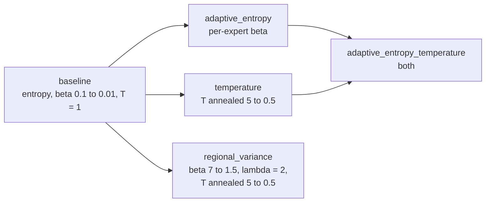

### 7.2 Results

Numbers are from the saved run `workspace/neural_SDE/gating_diagnostics_benchmark/20261108_114018`, summarised with `gate_health.py`. "Val" is the validation split at the last epoch. "Real" is Exp 2 on 2018–2020 paths.

| Variant | Val entropy | Val confidence | Val winners B / Br / H | Input dependence | `val_loss_sde` | Real winners B / Br / H | `event_contrast` | `event_mi` |
|---|---|---|---|---|---|---|---|---|
| baseline | 0.906 | 0.478 | .00 / .35 / .65 | 0.031 | −2.396 | .00 / .84 / .16 | 0.010 | 0.007 |
| adaptive_entropy | 0.935 | 0.446 | .36 / .15 / .49 | 0.060 | −2.418 | .60 / .10 / .30 | 0.012 | 0.004 |
| temperature | 0.934 | 0.455 | .01 / .83 / .16 | 0.058 | −2.376 | .77 / .11 / .12 | 0.018 | 0.009 |
| adaptive_entropy_temperature | 0.948 | 0.439 | .62 / .31 / .07 | 0.048 | −2.399 | .79 / .14 / .08 | 0.019 | 0.010 |
| regional_variance | **0.009** | **0.997** | **.36 / .33 / .31** | **0.989** | −2.408 | .24 / .33 / .44 | 0.012 | 0.005 |

| Variant | Verdict |
|---|---|
| baseline | starved-expert, uniform-soft, non-semantic |
| adaptive_entropy | uniform-soft, non-semantic |
| temperature | starved-expert, uniform-soft, non-semantic |
| adaptive_entropy_temperature | uniform-soft, non-semantic |
| regional_variance | non-semantic |

Gate entropy, where 1 is uniform and 0 is fully confident:

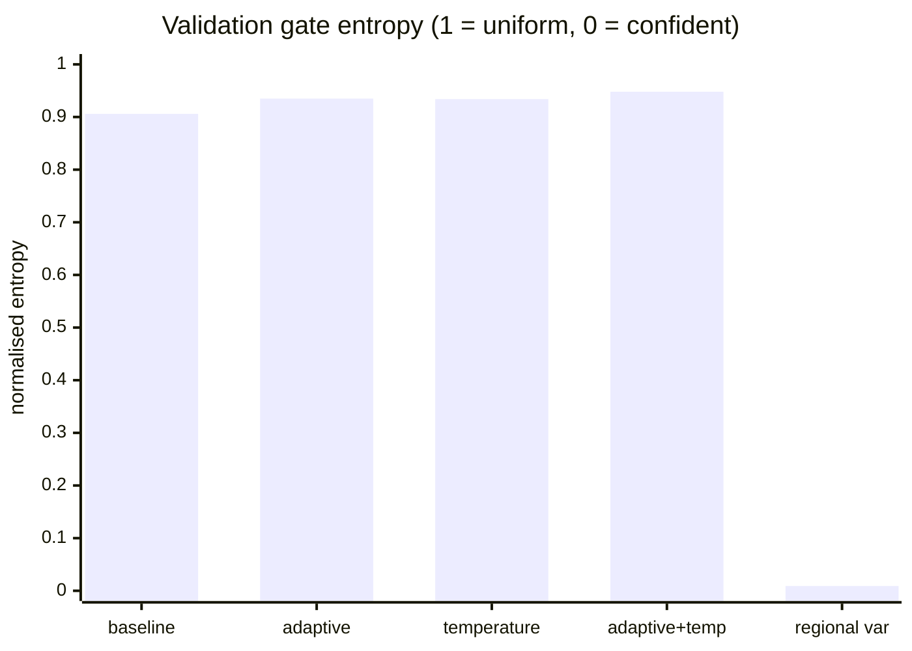

Event alignment, as the share of event uncertainty explained by the gate's choice:

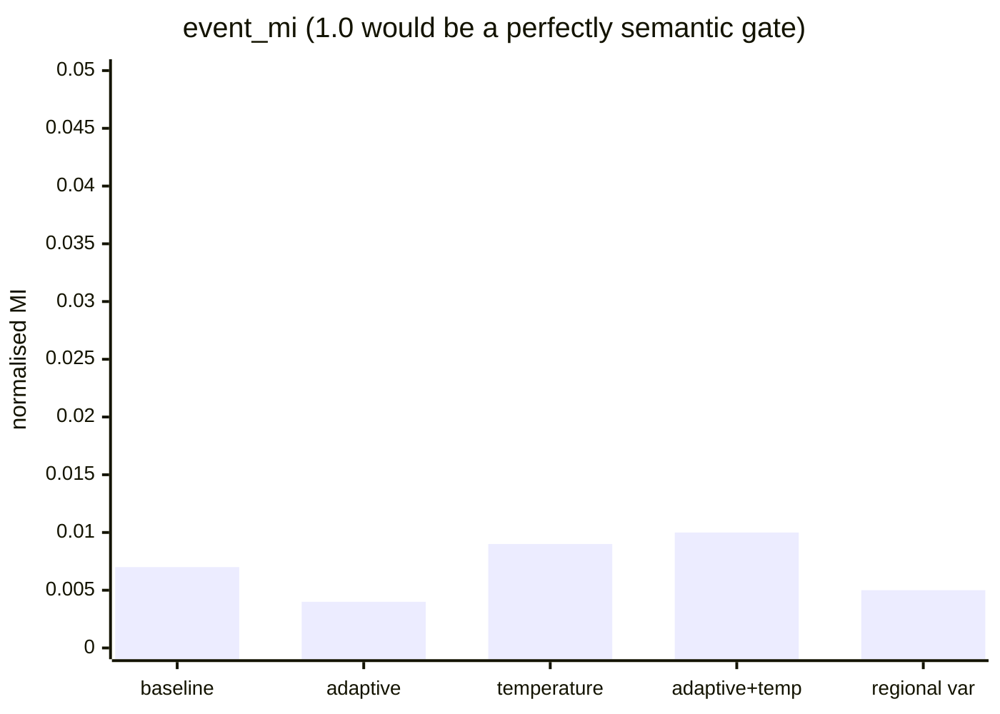

### 7.3 Reading the results

**The entropy family leaves the gate near-uniform.** The first four variants all have entropy above 0.9 and confidence below 0.5. Their gates give roughly a third to each expert on every input (input dependence 0.03–0.06).

**Their "winners" are decided by hair-thin margins, so they are unstable.** When all three weights are near 0.33, which one is largest is close to arbitrary. The winner shares flip between validation data and real paths:

| Variant | Top expert on validation | Top expert on real paths |
|---|---|---|
| baseline | Hover (65%) | Break (84%) |
| temperature | Break (83%) | Bounce (77%) |

**Regional variance fixes collapse.** It produces a gate that is confident (entropy 0.009), balanced (about a third each) and strongly dependent on its input (0.989). Its fit is no worse than the baseline's in this run.

**No variant is semantic.** `event_mi` is at most 0.010 and `event_contrast` at most 0.019. The gate's choice explains about 1% of which event is happening. The baseline's event table makes this concrete: on Bounce, Break and Hover events alike, the mean weights are about 0.17 / 0.47 / 0.35. The gate does not react to the event type at all.

**Conclusion of Experiment A.** The regulariser controls *how sharp and how balanced* the gate is. It does not control *what the gate is about*. That is set by the inputs and the objective.

**A note on the numbers.** The earlier study note quotes a previous run of the same five variants (`20261004_185041`), which is no longer on disk. Its values differ in the second or third decimal, and some winner shares differ more (which is itself evidence of the instability just described). The verdicts are identical. With one seed, differences in `val_loss_sde` of a few hundredths are within noise: Experiment B measured a seed-to-seed spread of 0.07–0.09.

---

## 8. Experiment B: gate-input features

### 8.1 Question and design

**Question.** Is the gate non-semantic because its inputs are uninformative (cause 1)? If the gate is given the features of section 5.7, does it become semantic?

**Design.** Six variants, three seeds each, 18 runs in total. This experiment also fixes weaknesses of Experiment A: the same list of 100 stocks is used for every seed, and the saved model is chosen on `val_loss_sde`, not on the total loss.

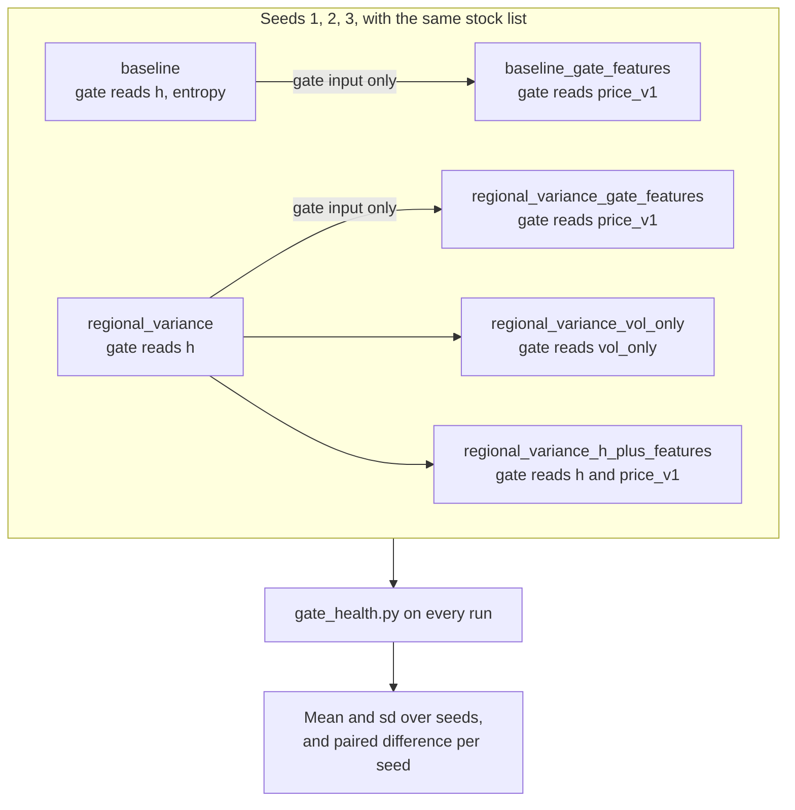

Each arrow is a **paired comparison**: same seed, same stocks, same data split, one change. Comparing within a seed removes most of the seed-to-seed noise.

### 8.2 Results

Mean ± standard deviation over 3 seeds. Winner shares are on real paths.

| Variant | `val_loss_sde` | Input dependence | Entropy | `event_mi` | `event_contrast` | Real winners B / Br / H | sd of winners |
|---|---|---|---|---|---|---|---|
| baseline | −2.470 ± 0.087 | 0.027 ± 0.019 | 0.882 | 0.003 ± 0.003 | 0.008 ± 0.002 | .12 / .38 / .50 | .21 / .42 / .44 |
| baseline_gate_features | **−2.521** ± 0.094 | 0.049 ± 0.035 | 0.607 | 0.001 ± 0.001 | 0.016 ± 0.006 | **.00 / .00 / 1.00** | 0 |
| regional_variance | −2.478 ± 0.072 | 0.857 ± 0.216 | 0.012 | 0.003 ± 0.001 | 0.000 ± 0.037 | .33 / .41 / .26 | .09 / .20 / .23 |
| regional_variance_gate_features | −2.500 ± 0.082 | **0.978 ± 0.009** | 0.021 | 0.009 ± 0.009 | **0.052** ± 0.017 | .34 / .40 / .26 | **.01 / .01 / .00** |
| regional_variance_h_plus_features | −2.464 ± 0.064 | 0.974 ± 0.022 | 0.025 | 0.003 ± 0.001 | 0.018 ± 0.039 | .36 / .33 / .31 | .04 / .07 / .09 |
| regional_variance_vol_only | −2.308 ± 0.288 | 0.925 ± 0.077 | 0.060 | **0.027** ± 0.005 | 0.048 ± 0.101 | .37 / .36 / .27 | .04 / .12 / .12 |

Verdict per seed:

| Variant | Seed 1 | Seed 2 | Seed 3 |
|---|---|---|---|
| baseline | starved, uniform-soft, non-semantic | uniform-soft, non-semantic | hard-collapse, non-semantic |
| baseline_gate_features | starved, non-semantic | starved, non-semantic | hard-collapse, non-semantic |
| regional_variance | non-semantic | non-semantic | starved, non-semantic |
| regional_variance_gate_features | healthy | healthy | non-semantic |
| regional_variance_h_plus_features | non-semantic | non-semantic | non-semantic |
| regional_variance_vol_only | healthy | healthy | non-semantic |

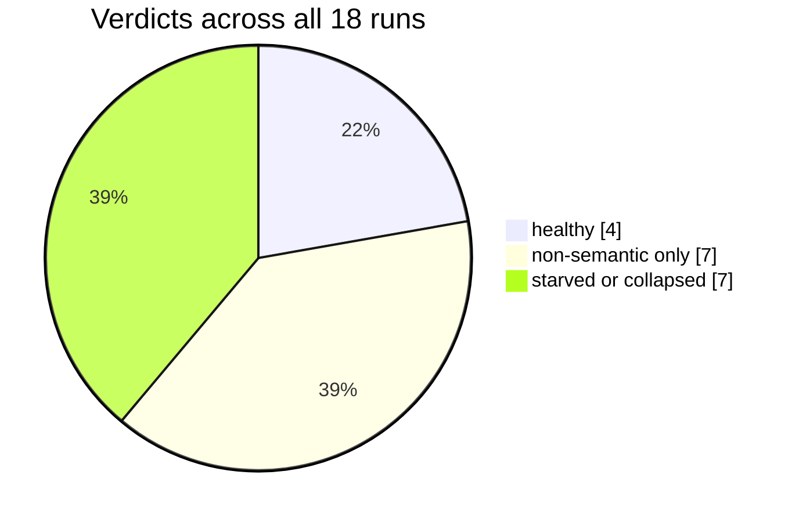

`event_contrast`, with the 0.05 threshold drawn as a line:

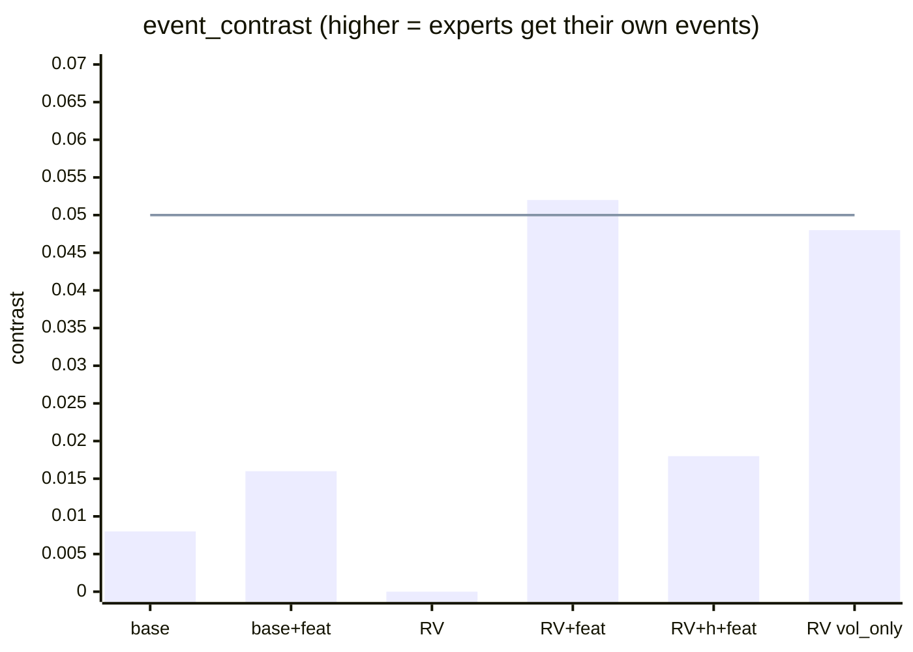

`event_mi`:

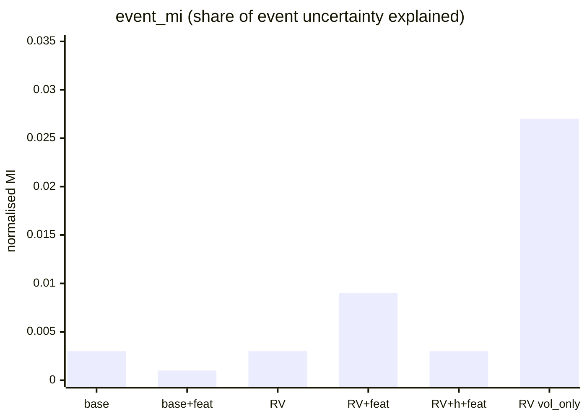

Reproducibility: how much the real winner shares vary between seeds, averaged over the three experts. Lower means every seed finds the same split. (`base+feat` scores 0 only because it always picks Hover.)

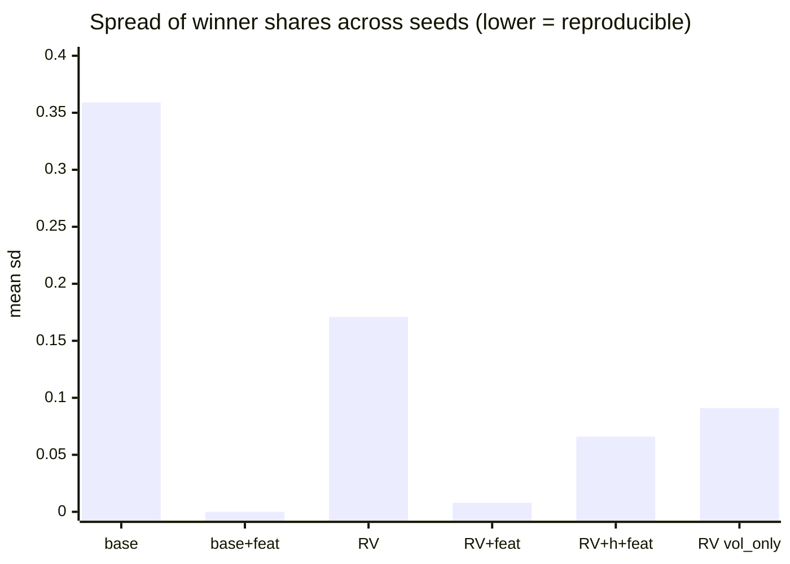

Paired differences (variant minus its reference, same seed):

| Pair | Metric | Seed 1 | Seed 2 | Seed 3 | Mean ± sd | Same sign on all 3? |
|---|---|---|---|---|---|---|
| base+feat − base | `val_loss_sde` | −0.057 | −0.035 | −0.061 | **−0.051 ± 0.014** | Yes, better (p ≈ 0.02) |
| | `event_mi` | −0.005 | −0.002 | 0.000 | −0.002 ± 0.003 | No |
| RV+feat − RV | `val_loss_sde` | −0.063 | +0.036 | −0.041 | −0.023 ± 0.052 | No |
| | `event_contrast` | +0.057 | +0.094 | +0.004 | **+0.051 ± 0.045** | Yes (p ≈ 0.19) |
| | `event_mi` | +0.014 | +0.002 | 0.000 | +0.006 ± 0.008 | Not negative on any |
| vol_only − RV | `val_loss_sde` | +0.042 | +0.477 | −0.011 | +0.169 ± 0.268 | No (seed 2 broke) |
| | `event_mi` | +0.016 | +0.028 | +0.027 | **+0.024 ± 0.007** | Yes (p ≈ 0.03) |
| h+feat − RV | `event_mi` | −0.003 | −0.001 | +0.003 | 0.000 ± 0.003 | No |
| | `event_contrast` | −0.039 | +0.080 | +0.011 | +0.018 ± 0.060 | No |

The p-values are paired t-tests with 2 degrees of freedom on rounded values. Treat them as indications only.

### 8.3 Finding 1: features without a regulariser improve fit but not routing

`baseline_gate_features` fits better than `baseline` on every seed, by 0.051 nats on average. Yet on real paths its top expert is **Hover on 100% of windows in all three seeds**.

Both facts have the same explanation:

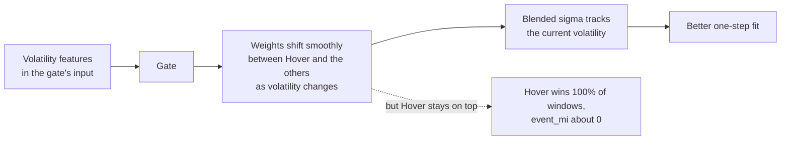

Hover has a small, capped $\sigma$. The other two experts have larger ones. By sliding weight between them, the gate can dial the blended $\sigma$ up and down. The new volatility features tell the gate exactly how much to dial. The gate becomes a **volatility regressor**: it improves the predicted variance without ever changing which expert leads.

This is cause 3 seen in the data, and it is the behaviour Weigend, Mangeas and Srivastava (1995) reported for gated experts on time series: without a competitive objective, the split follows volatility.

The fit gain is real. It comes from better variance prediction, not from recognising regimes.

### 8.4 Finding 2: features plus regional variance give a reproducible gate

Regional variance forces confident, varied routing. With the original input $h$, *which* split it finds depends on the seed: winner shares vary by 0.09–0.23 between seeds, and seed 3 starves the Hover expert entirely.

With `price_v1` features:

- **Reproducible.** Winner shares are 0.34 / 0.40 / 0.26 on every seed, varying by 0.01 or less. Every seed finds essentially the same split. This is the clearest positive result of the study.
- **Seed 3 is rescued.** No expert is starved.
- **Mildly aligned.** `event_contrast` rises on all three seeds and crosses the 0.05 threshold on two, giving two `healthy` verdicts.
- **Fit unchanged.** The difference in `val_loss_sde` has mixed signs.

But `event_mi` is still only 0.009. The gate's weights *lean* slightly toward the right expert on its events. Its actual choice still explains under 1% of the event type.

### 8.5 Finding 3: the alignment comes from volatility

If level distance, approach, velocity and dwell were what the gate used to recognise events, then removing them should hurt. The `vol_only` control removes all 12 and keeps the 2 volatility features:

| | `price_v1` gate (14 features) | `vol_only` gate (2 features) |
|---|---|---|
| `event_mi` | 0.009 ± 0.009 | **0.027 ± 0.005** |
| `event_contrast` | 0.052 ± 0.017 | 0.048 ± 0.101 |
| Verdicts | healthy, healthy, non-semantic | healthy, healthy, non-semantic |
| `val_loss_sde` | −2.500 ± 0.082 | −2.308 ± 0.288 |

The gate with only volatility matches the full gate on event alignment, and beats it on `event_mi` on all three seeds. So **the event alignment the gate gained is volatility alignment**. Breakouts tend to happen when volatility is expanding and hovers when it is contracting, and that correlation is all the gate has picked up.

A separate check supports this. A simple classifier trained to predict the event label directly from the features reached a balanced accuracy of 0.370 from `price_v1` and 0.367 from `vol_only`, against 0.333 for guessing. Nearly all the event information that is available without hindsight sits in the two volatility features.

Two details are worth understanding:

- **Why fewer features score higher on `event_mi`.** With only volatility to work with, regional variance must split on volatility, and that split happens to correlate with events. With 14 features, the regulariser has many other confident splits available that satisfy it equally well and have nothing to do with events. More inputs give the regulariser more ways to be confidently arbitrary.
- **Why the two event metrics disagree for `vol_only` on seed 3** (`event_mi` 0.029, `event_contrast` −0.067). The gate separates event types but attaches them to the *wrong* experts. Since Bounce and Break agree in sign 45.7% of the time, nothing in the objective pins a volatility cluster to a particular expert name. This is causes 2 and 4 seen directly.

The 12 non-volatility features do help with fit and stability. `vol_only` has the worst and most variable loss, and one of its runs (seed 2) appears to have failed.

### 8.6 Finding 4: mixing the features into $h$ dilutes them

`regional_variance_h_plus_features` gives the gate both $h$ and the new features. It behaves like plain regional variance: non-semantic on all seeds, no change in `event_mi`, less reproducible than the features-only gate. When offered the 23 numbers of $h$, the gate routes mostly on them. The features need to be the gate's *only* input to shape its behaviour.

### 8.7 The hypothesis, checked

```mermaid
flowchart TB
    H0["Hypothesis: the gate is non-semantic<br/>because its inputs are uninformative"] --> Q1{"Do better inputs change<br/>the gate's behaviour?"}
    Q1 -->|"Yes: reproducible split,<br/>seed 3 rescued, fit improves"| Q2{"Does the gate become<br/>Fibonacci-semantic?"}
    Q2 -->|"Weakly: contrast about 0.05,<br/>event_mi at most 0.03"| Q3{"Is that from the level features,<br/>or from volatility alone?"}
    Q3 -->|"Volatility alone does as well"| C["Better inputs were necessary<br/>but not sufficient.<br/>The objective rewards a volatility split,<br/>not a Bounce / Break split."]
```

---

## 9. What the experiments establish

| Problem | Status | What addressed it |
|---|---|---|
| Hard collapse and starved experts | Fixed | Regional variance with balance loss, plus gate features to make it hold on every seed |
| Uniform-soft gate | Fixed | Regional variance |
| Split depends on the random seed | Fixed | Gate reads `price_v1` features only |
| Gate reflects volatility, not Fibonacci events | **Open** | Nothing tried so far |
| Expert names are not pinned to behaviours | **Open** | Nothing tried so far |

The path of the investigation:

```mermaid
flowchart LR
    S0["Start<br/>gate collapses or is uniform"] --> S1["Experiment A<br/>change the regulariser"]
    S1 --> R1["Sharp and balanced,<br/>but arbitrary and seed-dependent"]
    R1 --> S2["Experiment B<br/>change the gate's inputs"]
    S2 --> R2["Sharp, balanced, reproducible,<br/>but it tracks volatility"]
    R2 --> S3["Next<br/>change the objective"]
```

The bottleneck has moved twice. First it looked like a regulariser problem. Experiment A showed that the regulariser can make the gate sharp but cannot give it meaning. Then it looked like an input problem. Experiment B showed that better inputs make the gate stable, but the gate uses them to follow volatility, because volatility is what the training objective pays for.

What remains is causes 2, 3 and 4 from section 4.2: **under moment mixing, the loss gives the gate no reason to separate Bounce from Break.**

---

## 10. Limitations

- **Few seeds.** Experiment A has one seed. Experiment B has three, where "the same direction on all three" has a two-sided sign-test p-value of 0.25. Only two paired results reach p < 0.05, and those rest on rounded values.
- **Validation is effectively in-sample.** Windows overlap by 251 of 252 days and are split at random, so a validation window is nearly identical to its training neighbours. The Exp 2 period (2018–2020) also overlaps the training period. The numbers rank variants against each other. They are not evidence of out-of-sample performance.
- **Event labels are sparse and use hindsight.** About 3% of windows are labelled, and Bounce and Break labels need 10 days of future prices. Even an ideal gate would score modestly. Compare variants with each other, not with 1.0.
- **Scaling mismatch in Exp 2.** The event detector scales future prices by the starting window, while the gate rescales every window. After a new high, a breakout above the top level looks to the model like "sitting at the top". This lowers measured alignment.
- **Verdicts sit on thresholds.** `healthy` requires `event_contrast` above 0.05. The best variant passes at 0.05–0.07 on two seeds and misses at 0.03 on the third, so "2 of 3 healthy" overstates the difference between variants.
- **One apparent failed run.** `regional_variance_vol_only` on seed 2 has a loss 0.48 worse than its reference. Its training log should be inspected before drawing conclusions from it.
- **Generation quality was not assessed.** Neither experiment checks whether the synthetic paths got better or worse. The sample generator also ignores the trained temperature and samples at $T = 1$.
- **Paper and code differ.** The paper describes 50 stocks over 2014–2017 and a 64/32 encoder. The code uses 100 stocks over 2014–2020 and a 32/16 encoder. The paper's own results (Jensen–Shannon distances of 0.04–0.13 for the model against 0.30–0.42 for the Vasicek baseline, and a TSTR accuracy of 61.83% against 61.88% for real data) were not re-verified here.

---

## 11. Next steps

```mermaid
flowchart LR
    A["Keep: gate reads price_v1 only"] --> B["Mixture likelihood<br/>experts compete for data points"]
    A --> C["Redefine Break as the<br/>exact opposite of Bounce"]
    B --> D["Re-run the pairs<br/>with 6 seeds,<br/>keeping the vol_only control"]
    C --> D
    D --> E{"Does price_v1 beat vol_only<br/>on both event metrics,<br/>on every seed?"}
    E -->|yes| F["Semantic gate.<br/>Then check generation and Exp 4"]
    E -->|"no, still a volatility split"| G["Add weak supervision<br/>from the event labels"]
```

**1. Replace moment mixing with a true mixture likelihood.** This addresses cause 2.

$$L_{\text{SDE}} = -\log \sum_{k=1}^{3} \pi_k \;\mathcal{N}\!\left(\Delta x \mid \mu_k,\ \sigma_k^2\right)$$

Under this loss, the gradient on the gate's score for expert $k$ is $\pi_k - h_k$, where

$$h_k = \frac{\pi_k\,\mathcal{N}(\Delta x \mid \mu_k, \sigma_k^2)}{\sum_j \pi_j\,\mathcal{N}(\Delta x \mid \mu_j, \sigma_j^2)}$$

is the *responsibility* of expert $k$: the share of credit it deserves for the observed move. The gate is pushed toward the expert that actually explained the data, and each expert learns mostly from the points it explains best. This is the competitive objective of Jacobs et al. (1991). Generation would then pick one expert at random according to $\pi$ and draw the move from it.

**2. Make Bounce and Break exact opposites.** This addresses cause 4. Define Break's drift as $-\text{sign}(x_t - L^\ast)\cdot\text{softplus}(\cdot)$: continuation *through* the nearest level, the mirror image of Bounce. Their signs would then never agree, and the expert names would be tied to distinguishable behaviour.

**3. Keep the `vol_only` control in every future benchmark.** The real test of a Fibonacci-semantic gate is that the full feature set **beats** the volatility-only gate on event alignment, not merely that it beats the original gate.

**4. Use more seeds.** With six seeds, six out of six in the same direction gives p ≈ 0.03.

**5. If the gate still splits on volatility, add weak supervision.** Add a penalty that pulls the gate toward the event labels on the 3% of windows that have them, strong at first and then faded, so that the likelihood can override labels it cannot fit.

Other options that remain open: a multi-step training objective, which would add up drift over several days and make direction visible (cause 3); a penalty or hidden-Markov structure that makes the gate persistent over time; the mutual-information reward of section 5.6; and a control that replaces the Fibonacci ratios with random ones, to test whether the data contains any Fibonacci-specific signal at all.

---

## 12. Where things live

| What | Path in `fibonacci_neural_sde/` |
|---|---|
| Model, gate and experts | `amgm/models/mlp.py` (`NeuralSDEMoE`, `GateHead`, `ExpertHead`) |
| Loss, schedules | `amgm/models/neural_SDE/runner.py` |
| Gate regularisers | `amgm/models/neural_SDE/gate_regularizers.py` |
| Gate features | `amgm/models/neural_SDE/gate_features.py` |
| Data windows and Fibonacci features | `amgm/data/neural_SDE.py` |
| Hyperparameters | `experiments/neural_SDE/trainer_cfg/neural_SDE/US_Stocks.py` |
| Training and generation | `experiments/neural_SDE/train_neural_SDE.py`, `generate_samples.py` |
| Event detector | `experiments/neural_SDE/fibonacci_state_detection.py` |
| Diagnostics (Exp 1, 2, 4) | `experiments/neural_SDE/gating_diagnostics/`, `analyze_gating.py`, `analyze_temporal_gating.py` |
| Both benchmarks | `experiments/neural_SDE/gate_collapse_benchmark.ipynb` |
| Experiment A outputs | `workspace/neural_SDE/gating_diagnostics_benchmark/20261108_114018/` |
| Experiment B outputs | `workspace/neural_SDE/gating_diagnostics_benchmark/gate_inputs_20261108_120037/seed_{1,2,3}/` |
| Paper | `Fibonacci_Neural_SDE.pdf` |

To reproduce the metric tables, run the health summary on a benchmark folder from the repository root:

```bash
.venv/bin/python -I <skill>/scripts/gate_health.py workspace/neural_SDE/gating_diagnostics_benchmark/20261108_114018
.venv/bin/python -I <skill>/scripts/gate_health.py workspace/neural_SDE/gating_diagnostics_benchmark/gate_inputs_20261108_120037/seed_1
```

where `<skill>` is `.claude/skills/fibonacci-sde-gating` in the `fibo-agent-platform` workspace.

### References cited

- Jacobs, Jordan, Nowlan & Hinton (1991). Adaptive mixtures of local experts. *Neural Computation* 3(1).
- Jordan & Jacobs (1994). Hierarchical mixtures of experts and the EM algorithm. *Neural Computation* 6(2).
- Weigend, Mangeas & Srivastava (1995). Nonlinear gated experts for time series. *International Journal of Neural Systems* 6.
- Chen, Deng, Wu, Gu & Li (2022). Towards understanding mixture of experts in deep learning. NeurIPS.
